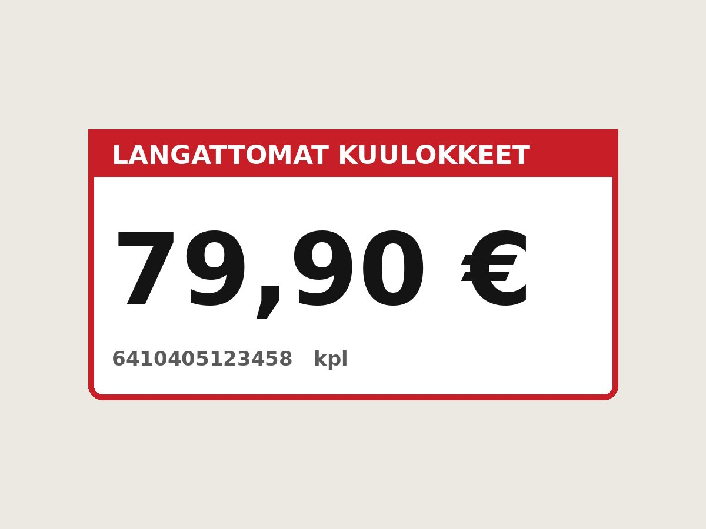
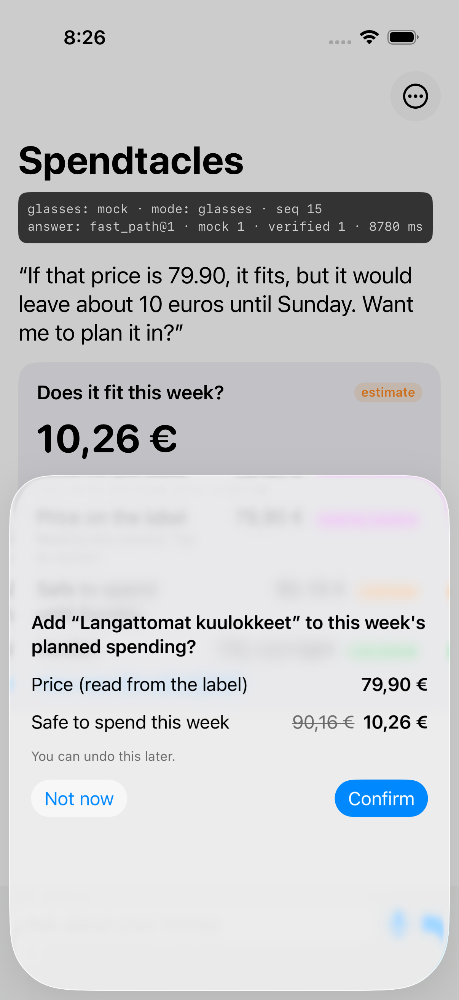
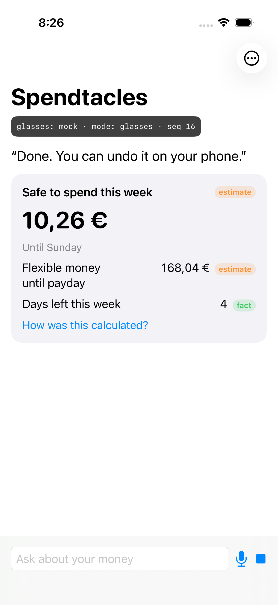

# Spendtacles

**A finance coach in your Ray-Ban Meta glasses.** Look at a price, ask *"Can I afford this?"* (or *"Onko minulla varaa tähän?"*), and hear an answer built on numbers you can check. Nothing changes without your OK.

Spendtacles is a glasses platform with one stable capability interface, and the money coach is the first capability that plugs into it. Built for Junction 2026, challenge *AI Glasses for Everyone, Everyday*.

## The demo flow

These screenshots come from CI, not a mock-up. The UI test runs the real iOS app in the iOS Simulator, with Meta's **Mock Device Kit** standing in for the glasses, against the real backend in fixture mode. ([`CompanionUITests.swift`](companion-ios/UITests/CompanionUITests.swift), [`ios.yml`](.github/workflows/ios.yml))

<table>
  <tr>
    <td align="center" width="25%"></td>
    <td align="center" width="25%"></td>
    <td align="center" width="25%"></td>
    <td align="center" width="25%"></td>
  </tr>
  <tr>
    <td valign="top"><b>0. What the glasses see.</b> The simulated camera is fed this price label.</td>
    <td valign="top"><b>1. Consent first.</b> No finance turn runs without a grant. Photos are deleted as soon as the price is read.</td>
    <td valign="top"><b>2. Answer + proposal.</b> <i>"If that price is 79.90, it fits, but it would leave about 10 euros until Sunday. Want me to plan it in?"</i> The proposal shows the before and after, and waits.</td>
    <td valign="top"><b>3. Confirmed.</b> One explicit tap, and the card updates to the new figure. Every value is labelled <i>fact</i>, <i>estimate</i>, <i>calculated</i> or <i>read by camera</i>.</td>
  </tr>
</table>

The dark strip under the title (`glasses: mock · mode: glasses · seq …`) is the debug overlay. It is there on purpose: **mocks are never silent** (DEC-005), so the app always shows when simulated glasses or fixture data are in play.

## Built to be trusted

- **The AI never invents numbers.** Every figure comes from a deterministic finance engine and carries a calculation ID. A verifier checks each spoken number and card value against the engine's log before it is sent, and drops any number the engine didn't calculate (covered by tests).
- **No action without confirmation.** Changes are proposals. Each confirmation is signed (ES256), single-use, expiring and policy-checked on the server. "Stop" aborts a turn and applies nothing.
- **The camera works only when you ask.** No always-on camera, no facial recognition. Before upload, a photo is rotated upright, stripped of EXIF and GPS data, and downscaled. The capability receives what was read from the label, not the photo.
- **Consent is fail-closed.** Revoking consent deletes the captures made under it.
- **Money is never a float.** Amounts are decimal strings end to end.

## Where the numbers come from

`FINANCE_SOURCE` picks the source. Whatever it is, the coach's wording and the trust rules above stay the same.

### No bank connected? Just say a number (`user_stated`)

The coach works without any bank data, and without a setup screen. The first time a question needs money figures, it asks one thing out loud and then answers the original question:

> "Can I afford this?" → "How much do you want to spend until Sunday?" → "About a hundred." → "Got it: 100 euros until Sunday. If the label's right, that leaves about 20. Want me to plan it in?"

- It understands digits and round number words in English and Finnish ("about a hundred", "noin sata"). An unclear answer gets one retry, then the coach drops the question politely. It never guesses.
- The amount carries over to later weeks. Saying "my budget this week is 60" changes it, and confirmed plans count down from it.
- Cards label it *"Your weekly amount, as you told me"* and say no bank is connected. These are the user's own figures, so they are not reported as a mock.

### The team's money engine on transaction data (`s_pankki`)

The answers come from our teammate's deterministic money engine, run on the Junction 2026 synthetic transaction dataset ([`finance-engine/`](finance-engine/README.md), DEC-024). It answers per day until payday, the way the engine computes it (DEC-025):

> "What's safe to spend?" → "You can safely spend about 32 euros a day for the next 10 days, until payday."
>
> "Can I afford this?" (79,90 € label) → "If that price is 79.90, it fits. You'd still have about 24 euros a day until payday. Want me to plan it in?"

- The engine's floats become decimal strings at the boundary, and every figure gets a `calc_id` that the verifier resolves back through the engine service.
- The dataset is synthetic history, so "today" is a fixed simulated date (2026-09-05). Every result says so.
- The demo customer is CUST04069. A customer whose bills exceed their balance is told plainly that nothing is safe to spend.
- We are still confirming with the organisers that teams outside the S-Pankki challenge may use this dataset. If not, `user_stated` becomes the demo source (DEC-026).

### Fixture (`fixture`, the default)

Fixed demo numbers (€90.16 safe to spend this week), reported as `mock` everywhere. This is what CI and the screenshots above use.

## What's real and what's mocked

| | |
|---|---|
| **Real** | Orchestrator, consent, capture pipeline, confirmation signing, number verification, contracts, iOS companion core, the DAT SDK integration (built and driven in CI with Mock Device Kit), and the team's money engine on transaction data (`s_pankki`, on a simulated date) |
| **Mocked** (labelled `mock` in `/health` and on screen) | The `fixture` finance source, the label reader (always returns the demo €79.90 label), and the coach agent (client designed and tested against a fake agent, not yet connected) |
| **Behind flags** | "Hey Meta" voice launch and glasses-tap confirmation are experimental in DAT 1.0.1, so each has a fallback (DEC-004, DEC-022) |

## Repository layout

| Path | What it is |
|---|---|
| [`backend/`](backend/README.md) | Platform orchestrator + money-coach adapter. TypeScript, Node 22, Fastify. 63 tests. |
| [`companion-ios/`](companion-ios/README.md) | iOS companion: glasses session, Bluetooth audio, speech, capture, cards. Swift, SwiftUI, Meta Wearables DAT 1.0.1. |
| [`finance-engine/`](finance-engine/README.md) | HTTP service in front of the team's Python money engine: decimal strings, `calc_id`s, calculation lookups. Python, FastAPI. 10 tests. |
| [`contracts/`](contracts/README.md) | Versioned JSON Schema contracts, valid/invalid examples as tests, generated TS/Swift/Kotlin/Python types, OpenAPI specs, the adapter interface |
| [`docs/ARCHITECTURE.md`](docs/ARCHITECTURE.md) | Platform architecture |
| [`docs/ARCHITECTURE_DECISION_LOG.md`](docs/ARCHITECTURE_DECISION_LOG.md) | 26 decisions (DEC-001 to DEC-026), each with alternatives, evidence and revisit triggers |
| [`docs/SOURCES.md`](docs/SOURCES.md), [`docs/adr/evidence/`](docs/adr/README.md) | Source register and research write-ups |
| [`docs/finance/REFERENCE_DESIGN.md`](docs/finance/REFERENCE_DESIGN.md) | Finance-domain reference design |

Some internal names still say S-Bank (`sbank.coach`, `SBankCoachAdapter`, `backend/src/capabilities/sbank-coach/`, the `s_pankki` source). They are kept until after the hackathon so the contracts don't change hours before judging (DEC-026). Older decision entries say "S-Bank Coach" for what is now the money coach.

## Run it

```bash
# Contracts: validate schemas and examples, regenerate types
cd contracts && npm install && npm run check

# Backend (fixture data, demo token)
cd backend && npm install && npm test && npm run dev    # http://localhost:8787
FINANCE_SOURCE=user_stated npm run dev                  # no bank data: the coach asks for a weekly amount
FINANCE_SOURCE=s_pankki npm run dev                     # the team's engine (start finance-engine/ first; FINANCE_ENGINE_URL, default :8790)
curl -H 'authorization: Bearer demo-token' localhost:8787/health

# iOS companion core (macOS or Linux): unit tests, then the end-to-end smoke test against the running backend
cd companion-ios && swift test
BACKEND_URL=http://localhost:8787 swift run companion-smoke
```

The app itself needs Xcode. No Mac? The [`iOS companion`](.github/workflows/ios.yml) workflow builds it on GitHub's macOS runners, runs the UI test above against Mock Device Kit, and uploads each step's screenshot as the `ios-screenshots` artifact. Setup for real glasses is in [`companion-ios/README.md`](companion-ios/README.md).

## What's next

Real bank data through a PSD2 sandbox, a real label reader, receipt matching, connecting the coach agent, then more capabilities on the same platform.
