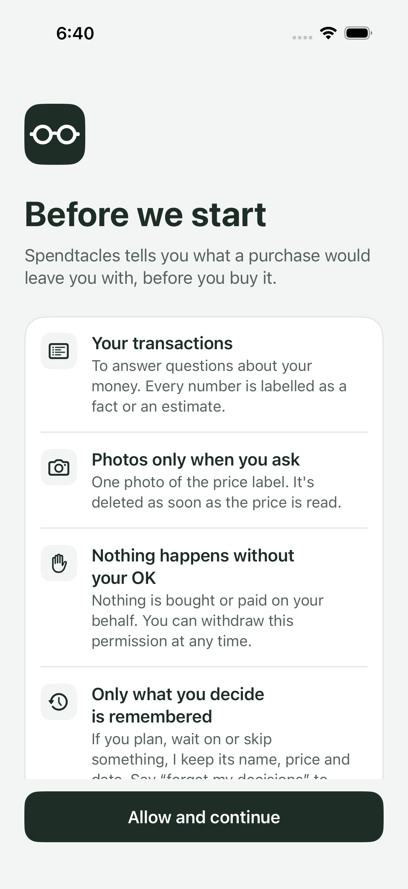
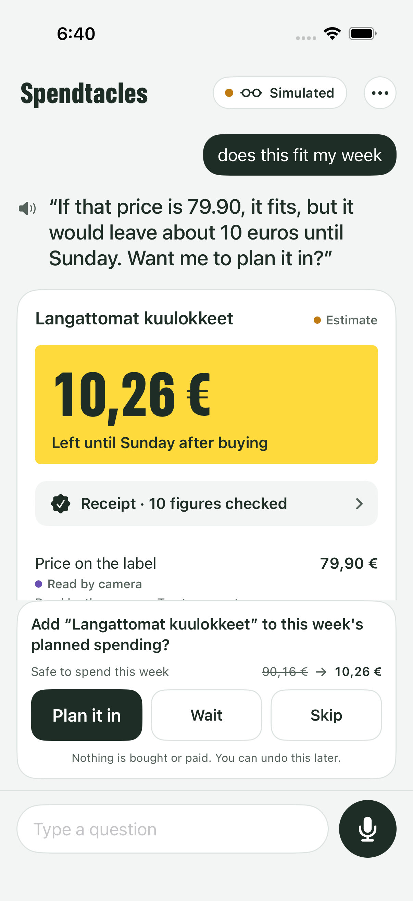
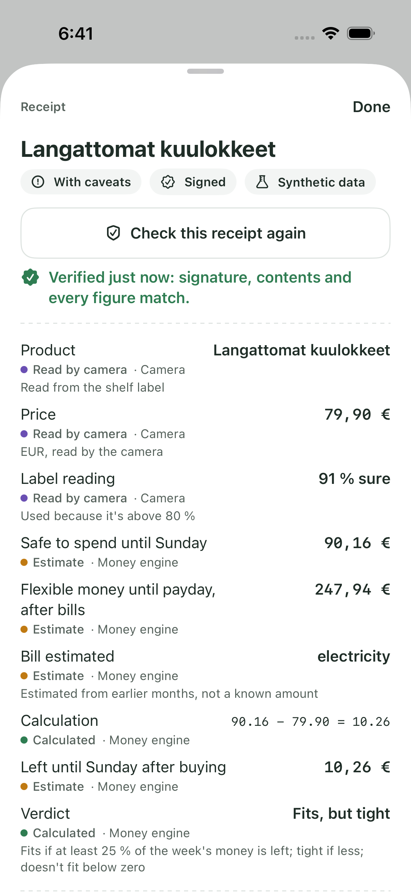
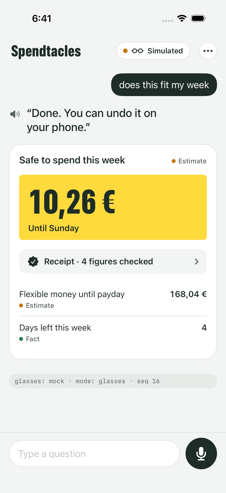

# Spendtacles

## Save money before you spend it.

Spendtacles puts a money coach in your Ray-Ban Meta glasses. Look at a price, ask *"Can I afford this?"* (or *"Onko minulla varaa tähän?"*), and hear what buying it would leave you to live on, while the item is still on the shelf. Nothing changes without your OK.

**Why glasses.** Money decisions happen in the shop aisle, not in the banking app. By the time you open an app to check your budget, you've already paid. Spendtacles answers at the moment you decide, so you can put it back before it costs you.

Under the hood, Spendtacles is a glasses platform with one stable capability interface, and the money coach is the first capability that plugs into it. Built for Junction 2026, challenge *AI Glasses for Everyone, Everyday*.

## The demo flow

These screenshots come from CI, not a mock-up. The UI test runs the real iOS app in the iOS Simulator, with Meta's **Mock Device Kit** standing in for the glasses, against the real backend in fixture mode. ([`CompanionUITests.swift`](companion-ios/UITests/CompanionUITests.swift), [`ios.yml`](.github/workflows/ios.yml))

<table>
  <tr>
    <td align="center" width="20%"></td>
    <td align="center" width="20%"></td>
    <td align="center" width="20%"></td>
    <td align="center" width="20%"></td>
    <td align="center" width="20%"></td>
  </tr>
  <tr>
    <td valign="top"><b>0. What the glasses see.</b> The simulated camera is fed this price label.</td>
    <td valign="top"><b>1. Consent first.</b> What's used, what's remembered, and that nothing is bought for you.</td>
    <td valign="top"><b>2. The answer.</b> <i>"If that price is 79.90, it fits, but it would leave about 10 euros until Sunday. Want me to plan it in?"</i> The card is about the item. Plan it in, wait or skip.</td>
    <td valign="top"><b>3. Show me why.</b> The Purchase Receipt: every figure, where it came from, what's uncertain. "Check this receipt again" has the server re-verify it.</td>
    <td valign="top"><b>4. Confirmed.</b> One explicit tap. The updated week comes back with its own signed receipt.</td>
  </tr>
</table>

The header pill says **Simulated** and the grey strip at the end (`glasses: mock · mode: glasses · seq …`) is the debug overlay. Both are there on purpose: **mocks are never silent** (DEC-005), so the app always shows when simulated glasses or fixture data are in play. Receipts say **Synthetic data** for the same reason.

## Show me why

Spendtacles doesn't just say whether you can afford something. It shows what the decision means for your money and proves how it got there.

- **The Purchase Receipt.** Every answer links to a receipt, set like a till receipt: the product and price read by the camera (and how sure it was), the money available, the bills taken off first, the calculation itself (`90.16 − 79.90 = 10.26`), what's left, the verdict rule, and how fresh the data is. Every line says where it came from: camera, you, the money engine or the coach (DEC-029).
- **Signed, and checkable by anyone.** The platform signs each receipt only after every figure on it has been matched to the money engine's calculation log. "Check this receipt again" sends the card back to `POST /v1/receipts/verify`, which re-checks the signature, the contents and every figure. Change one number and it fails.
- **It refuses to guess.** If the label could say 19.90 or 79.90, it asks: *"I can't read that price reliably. Is it 19.90 or 79.90?"* If account data is missing, more than a week old or conflicting, or an upcoming bill is unknown, it gives no verdict and says why (DEC-030).
- **Buy now, wait or skip.** Each answer shows all three, from the same engine results: what's left if you buy, that nothing changes if you wait, and what stays available if you skip. Say "I'll wait" or "skip it" and it remembers; say "forget my decisions" and it doesn't (DEC-031).
- **Measured, not asserted.** `npm run eval` runs 19 synthetic scenarios, 15 of them critical. Current result: **0 false-safe answers**, every scenario passed, every receipt verified, tampering detected. Disabling the safety checks makes it fail. See [`docs/eval/RESULTS.md`](docs/eval/RESULTS.md) (DEC-032).

## Built to be trusted

- **The AI never invents numbers.** Every figure comes from a deterministic finance engine and carries a calculation ID. A verifier checks each spoken number and card value against the engine's log before it is sent, and drops any number the engine didn't calculate (covered by tests).
- **No action without confirmation.** Changes are proposals. Each confirmation is signed (ES256), single-use, expiring and policy-checked on the server. "Stop" aborts a turn and applies nothing.
- **The camera works only when you ask.** No always-on camera, no facial recognition. Before upload, a photo is rotated upright, stripped of EXIF and GPS data, and downscaled. The capability receives what was read from the label, not the photo.
- **Consent is fail-closed.** Revoking consent deletes the captures made under it.
- **Money is never a float.** Amounts are decimal strings end to end.

## Where the numbers come from

`FINANCE_SOURCE` picks the source. Whatever it is, the coach's wording and the trust rules above stay the same.

### No bank connected? Just say a number (`user_stated`)

The coach works without any bank data, and without a setup screen. The first time a question needs money figures, it asks one thing out loud and then answers the original question:

> "Can I afford this?" → "How much do you want to spend until Sunday?" → "About a hundred." → "Got it: 100 euros until Sunday. If the label's right, that leaves about 20. Want me to plan it in?"

- It understands digits and round number words in English and Finnish ("about a hundred", "noin sata"). An unclear answer gets one retry, then the coach drops the question politely. It never guesses.
- The amount carries over to later weeks. Saying "my budget this week is 60" changes it, and confirmed plans count down from it.
- Cards label it *"Your weekly amount, as you told me"* and say no bank is connected. These are the user's own figures, so they are not reported as a mock.

### The team's money engine on transaction data (`s_pankki`)

The answers come from our teammate's deterministic money engine, run on the Junction 2026 synthetic transaction dataset ([`finance-engine/`](finance-engine/README.md), DEC-024). It answers per day until payday, the way the engine computes it (DEC-025):

> "What's safe to spend?" → "You can safely spend about 32 euros a day for the next 10 days, until payday."
>
> "Can I afford this?" (79,90 € label) → "If that price is 79.90, it fits. You'd still have about 24 euros a day until payday. Want me to plan it in?"

- The engine's floats become decimal strings at the boundary, and every figure gets a `calc_id` that the verifier resolves back through the engine service.
- The dataset is synthetic history, so "today" is a fixed simulated date (2026-09-05). Every result says so.
- The demo customer is CUST04069. A customer whose bills exceed their balance is told plainly that nothing is safe to spend.
- We are still confirming with the organisers that teams outside the S-Pankki challenge may use this dataset. If not, `user_stated` becomes the demo source (DEC-026).

#### How the money engine works

The engine (*Personal Economic Trainer*, in our teammate's private repo) reads a customer's transaction history and works out, with plain arithmetic, how much is safe to spend. There is no AI inside it: the same data always gives the same answer, and every step can be checked.

**1. It sorts every transaction into three groups.**

| Group | Examples | Meaning |
|---|---|---|
| Must-pay, regular | Rent, utilities, groceries, commuting | Arrives every month, roughly the same amount |
| Must-pay, irregular | Health, home and tech | Unavoidable, but lumpy |
| Flexible | Restaurants, entertainment, shopping, taxis | The money that slips through your fingers |

**2. It finds the pay cycle.** It learns from history when salary usually lands (in this dataset, mostly on the 15th), so it knows how many days are left until payday.

**3. It works out what is safe to spend today.** With the demo customer's real numbers:

```
  Balance right now                          €1,374.22
− Bills still due before payday               −€626.30   (typical cycle, last 6 pay cycles)
− Reserve for surprise must-pay costs         −€227.81   (from the last 12 pay cycles)
− Savings they usually move                     −€0.00
− Safety cushion                              −€200.00
= Free until payday                             €320.11
÷ 10 days to payday
= Safe to spend today                       €32.01 a day
```

A €79.90 purchase then leaves €240.21, or **€24.02 a day**, which is what the glasses say. The rule corrects itself every day: spend less today and tomorrow's figure goes up.

**4. The safety buffer was tested, not guessed.** The team compared cushion and reserve settings on the first year of data, then checked the winner on the second year, which it had never seen. The chosen setting (a €200 cushion plus a typical-month reserve) prevented more overdrafts *and* made people wait less to spend than the original setting.

**5. Results.** These come from the team's two-year backtest on 5,000 customers. They are the team's own figures; the platform side has not re-run them.

- **89 % fewer overdraft days** when people follow the daily limit.
- **94 % fewer** when combined with a savings plan.
- **No overfitting:** settings chosen on year 1 held up on year 2.
- **An honest finding:** advice only works if it's followed. At 75 % compliance, the gain drops sharply.

**It can do more than the demo shows:**

- **A savings plan** that splits a goal (for example 5 % of income) across spending categories, cutting most where you spend far more than people of your age and income.
- **An overdraft risk estimate**, by replaying your past months as scenarios to estimate the chance of going below zero before payday.

**How it connects to the glasses.** [`finance-engine/`](finance-engine/README.md) imports the engine unchanged and does three things:

- turns each figure into an exact decimal string (`"32.01"`), never a floating-point number;
- gives each result a receipt (a `calc_id`) and logs it;
- lets the backend look each receipt up before anything is spoken. A number missing from the log is dropped.

Two figures are still computed by that service rather than the engine: the fits / tight / doesn't-fit verdict, and how a confirmed plan reduces the money left. Each result says so in its assumptions.

### Fixture (`fixture`, the default)

Fixed demo numbers (€90.16 safe to spend this week), reported as `mock` everywhere. This is what CI and the screenshots above use.

## What's real and what's mocked

| | |
|---|---|
| **Real** | Orchestrator, consent, capture pipeline, confirmation signing, number verification, contracts, iOS companion core, the DAT SDK integration (built and driven in CI with Mock Device Kit), and the team's money engine on transaction data (`s_pankki`, on a simulated date) |
| **Mocked** (labelled `mock` in `/health` and on screen) | The `fixture` finance source and its synthetic scenarios (`FIXTURE_SCENARIO`), the label reader (scripted readings: the €79.90 headphones label by default, or a sequence such as `LABEL_FIXTURE_SEQUENCE=clear,ambiguous`), and the coach agent (client designed and tested against a fake agent, not yet connected) |
| **Behind flags** | "Hey Meta" voice launch and glasses-tap confirmation are experimental in DAT 1.0.1, so each has a fallback (DEC-004, DEC-022) |

## Repository layout

| Path | What it is |
|---|---|
| [`backend/`](backend/README.md) | Platform orchestrator + money-coach adapter, trust gate, receipts, decision memory. TypeScript, Node 22, Fastify. 83 tests, plus the evaluation harness in `backend/eval/`. |
| [`companion-ios/`](companion-ios/README.md) | iOS companion: glasses session, Bluetooth audio, speech, capture, cards. Swift, SwiftUI, Meta Wearables DAT 1.0.1. |
| [`finance-engine/`](finance-engine/README.md) | HTTP service in front of the team's Python money engine: decimal strings, `calc_id`s, calculation lookups. Python, FastAPI. 10 tests. |
| [`contracts/`](contracts/README.md) | Versioned JSON Schema contracts, valid/invalid examples as tests, generated TS/Swift/Kotlin/Python types, OpenAPI specs, the adapter interface |
| [`docs/ARCHITECTURE.md`](docs/ARCHITECTURE.md) | Platform architecture |
| [`docs/ARCHITECTURE_DECISION_LOG.md`](docs/ARCHITECTURE_DECISION_LOG.md) | 32 decisions (DEC-001 to DEC-032), each with alternatives, evidence and revisit triggers |
| [`docs/eval/RESULTS.md`](docs/eval/RESULTS.md) | Evaluation results: false-safe answers, abstention, receipt verification, latency |
| [`docs/demo/DEMO_SCRIPT.md`](docs/demo/DEMO_SCRIPT.md) | The judge demo, with exact lines and fallbacks |
| [`docs/SOURCES.md`](docs/SOURCES.md), [`docs/adr/evidence/`](docs/adr/README.md) | Source register and research write-ups |
| [`docs/finance/REFERENCE_DESIGN.md`](docs/finance/REFERENCE_DESIGN.md) | Finance-domain reference design |

Some internal names still say S-Bank (`sbank.coach`, `SBankCoachAdapter`, `backend/src/capabilities/sbank-coach/`, the `s_pankki` source). They are kept until after the hackathon so the contracts don't change hours before judging (DEC-026). Older decision entries say "S-Bank Coach" for what is now the money coach.

## Run it

```bash
# Contracts: validate schemas and examples, regenerate types
cd contracts && npm install && npm run check

# Backend (fixture data, demo token)
cd backend && npm install && npm test && npm run dev    # http://localhost:8787
FINANCE_SOURCE=user_stated npm run dev                  # no bank data: the coach asks for a weekly amount
FINANCE_SOURCE=s_pankki npm run dev                     # the team's engine (start finance-engine/ first; FINANCE_ENGINE_URL, default :8790)
curl -H 'authorization: Bearer demo-token' localhost:8787/health
LABEL_FIXTURE_SEQUENCE=clear,ambiguous npm run dev      # the demo: headphones, then a smudged label (docs/demo/DEMO_SCRIPT.md)
FIXTURE_SCENARIO=unknown_bill npm run dev               # see the coach abstain (also: stale, conflict, missing, insufficient, pace)

# Evaluation and a device-free demo
npm run eval -- --check                                 # writes docs/eval/RESULTS.md; fails on any false-safe answer
npm run demo                                            # the demo conversation in the terminal, plus a receipt check and a tamper check

# iOS companion core (macOS or Linux): unit tests, then the end-to-end smoke test against the running backend
cd companion-ios && swift test
BACKEND_URL=http://localhost:8787 swift run companion-smoke
```

The app itself needs Xcode. No Mac? The [`iOS companion`](.github/workflows/ios.yml) workflow builds it on GitHub's macOS runners, runs the UI test above against Mock Device Kit, and uploads each step's screenshot as the `ios-screenshots` artifact. Setup for real glasses is in [`companion-ios/README.md`](companion-ios/README.md).

## What's next

Real bank data through a PSD2 sandbox; a real label reader, measured against labelled photos with the 80 % threshold tuned; persisting receipts and decisions with a retention policy; matching shop receipts to decisions; connecting the coach agent; then more capabilities on the same platform.
