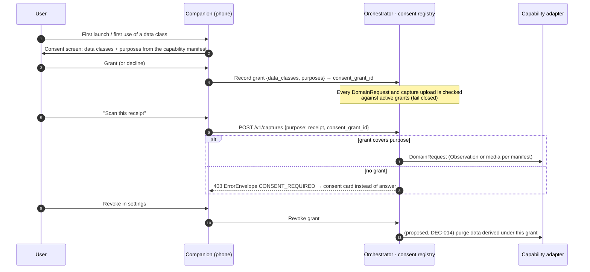
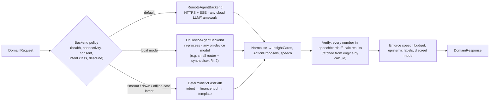

# Glasses-to-Action Platform: Architecture with S-Bank Coach as the First Capability

*Junction 2026 · Platform design v1.1 · updated 2026-11-14*

> **Document map:**
> - **This document** is the platform architecture.
> - **Why each choice was made:** [`ARCHITECTURE_DECISION_LOG.md`](./ARCHITECTURE_DECISION_LOG.md) (DEC-###).
> - **Sources:** [`SOURCES.md`](./SOURCES.md), with research write-ups in [`adr/evidence/`](./adr/evidence/).
> - **Contract index:** [`contracts/README.md`](./contracts/README.md).
> - **Finance-domain reference design** (ledger, receipt matching, safe-to-spend engine, tools): [`finance/REFERENCE_DESIGN.md`](./finance/REFERENCE_DESIGN.md). The S-Bank Coach team owns the agent and may follow that design or not.
>
> The platform depends only on the contracts in §3 and §5, never on the agent's model, prompts, framework or database (DEC-010, DEC-017).
>
> **The executable versions of §3 and §5 are in [`../contracts/`](../contracts/README.md)** (JSON Schemas, valid and invalid examples, generated TS/Swift/Kotlin/Python types, OpenAPI specs). Where this document and the schemas differ, **the schemas win**.

> **Meta platform facts this design relies on.** These were verified 2026-11-14 against DAT SDK 1.0.1; re-check on every SDK upgrade. Evidence: [`adr/evidence/meta-dat.md`](./adr/evidence/meta-dat.md).
> - **Native SDK.** The Wearables Device Access Toolkit (DAT) is a native iOS 17.2+ (Swift) / Android 10+ (Kotlin) SDK. Glasses are registered through the **Meta AI app**; Developer Mode is enabled there. [S04]
> - **Stable vs experimental features.**
>   - DAT 1.0 began rolling out **30 Sep 2026** with camera, microphone, audio and motion/IMU as stable features. [S05]
>   - **Experimental in 1.0.0, so apps using them cannot be published yet:** voice invocations (*"Hey Meta, start ‹app›"* only launches or foregrounds the app; it delivers a `LaunchApp` action with no utterance, and the spoken name is configured in the Developer Center, DEC-021), glasses Inputs (taps and swipes), DAT Speech, standalone photo capture, camera audio streaming and Motion. [S03] We use them only behind flags, each with a publishable fallback (DEC-004).
>   - **Photo capture during an active stream is not experimental.** It is our capture path (DEC-006).
> - **A single touchpad tap pauses an active camera stream.** [S01, S02] This affects gesture confirmation (DEC-007).
> - **Microphone and speakers use Bluetooth HFP or A2DP**, which are mutually exclusive. The mic is an OS permission, not a Meta AI one, and HFP must be routed before a stream starts. [S04]
> - **Display output** for Meta Ray-Ban Display (FlexBox, Text, Image, Button, Icon, Video, ButtonGroup) is in developer preview. Since 1.0.0 the Mock Device Kit *does* simulate the 600×600 display; the FAQ still says otherwise and is outdated. [S04, S06]
> - **Display Web Apps cannot use the camera or capture microphone audio.** WebMCP is off by default and enabled per device. Both are optional output accelerators only (DEC-003). [S09]
> - **Publishing and testing.** Public publishing is not open yet. Preview builds go to testers through one private release channel per integration; check the channel's tester limit. Capability availability **varies by device**. [S04, S05]
> - **Meta AI Connectors** are described as "developer preview" (FAQ) and "early access" (Connect recap). We treat them as a future channel (DEC-020). [S05, S07]
> - **Licence and telemetry.** The SDK and samples are licensed under the Meta Wearables Developer Terms, not open source. We write our own `GlassesBridge` (DEC-002) and opt out of SDK analytics and crash reporting (DEC-015). [S08]

---

## 1. Architectural thesis

Build **one thin, typed boundary** between a *domain-agnostic glasses runtime* and *pluggable domain capabilities*, and make S-Bank Coach the first capability to plug into it. For the judges, the demo is an S-Bank story: a hands-free question about this week's money, answered in a short spoken sentence with a verifiable card on the phone, a receipt captured from the glasses, a change proposal confirmed with one explicit tap, and the same answer still available on the phone alone when the glasses drop out. For the platform, the same run shows that **devices, sessions, voice, capture, consent, confirmation, response composition and observability belong to the platform**, while **intents, tools, calculations, data and wording rules belong to the domain**.

**Domain-agnostic (reused by every capability):**
- glasses session and capability negotiation;
- audio routing, speech recognition and speech output;
- capture pre-processing and ephemeral media storage;
- platform intents (confirm / cancel / repeat / show on phone);
- capability registry and routing;
- consent registry;
- action-proposal ledger and signed confirmations;
- spoken-response budget and discreet mode;
- the schema-driven card renderer;
- notification policy;
- telemetry and the evaluation harness.

**Finance-only:**
- the S-Bank Coach agent and its adapter;
- the finance engine (ledger, three-basket classification, safe-to-spend, simulations, receipt matching, calculation log);
- the finance education corpus;
- the finance capability manifest, fixtures and wording rules.

The engine stays **independently verifiable**: the platform checks the agent's numbers against the engine's calculation log, not against the agent's own word.

---

## 2. Target architecture

### 2.1 Diagram

```mermaid
flowchart TB
  classDef reusable fill:#e3f6e8,stroke:#2f8a4a,color:#103a1d
  classDef finance fill:#fde8e8,stroke:#b03a3a,color:#4a0f0f
  classDef meta fill:#e6eef8,stroke:#3a6ea5,color:#0f2a4a
  classDef store fill:#f2f2f2,stroke:#777,color:#222
  classDef proposed fill:#fff,stroke:#999,stroke-dasharray:4 3,color:#555

  subgraph L1["L1 · Ray-Ban Meta interaction layer (glasses + Meta AI app)"]
    G_MIC["Mics (Bluetooth HFP)"]:::meta
    G_SPK["Open-ear speakers (HFP / A2DP)"]:::meta
    G_CAM["Camera: user-initiated still<br/>during a short stream"]:::meta
    G_INV["'Hey Meta, start ‹app›' [exp]<br/>capture button · inputs [exp]"]:::meta
    G_DSP["Display (optional, Ray-Ban Display)"]:::meta
    G_WEB["Display Web App + WebMCP<br/>(optional; no camera / mic)"]:::meta
  end

  subgraph L2["L2 · Native companion / session layer (phone)"]
    BRIDGE["GlassesBridge: only module importing DAT<br/>backend = dat | mock (always reported)"]:::reusable
    SESS["Lifecycle tracker: registration · session ·<br/>camera · interaction → DeviceSessionState"]:::reusable
    FLAGS["Experimental-feature flags<br/>(set by hour-0 device gate)"]:::reusable
    AUDIO["Audio route manager<br/>(HFP before stream · A2DP for TTS · half-duplex)"]:::reusable
    ASR["Speech in (ModelProvider: device ASR)"]:::reusable
    TTS["Speech out (ModelProvider: device TTS)<br/>flush on stop / barge-in"]:::reusable
    CAPPRE["Capture pre-processing<br/>(orient → strip EXIF/GPS → downscale)"]:::reusable
    PGRAM["Platform-intent grammar<br/>(confirm / cancel / repeat / stop)"]:::reusable
    CACHE["Offline card cache"]:::reusable
  end

  subgraph L3["L3 · Cross-domain orchestration & consent (backend)"]
    DEVST["Device-state store<br/>(latest seq per session)"]:::reusable
    TURN["Turn manager + capability router<br/>(routes on transcript, abort propagation)"]:::reusable
    POLICY["Policy check: consent · manifest ·<br/>device state · confirm channel"]:::reusable
    CONSENT["Consent registry"]:::reusable
    PROP["Action-proposal ledger<br/>+ confirmation signer"]:::reusable
    COMPOSE["Response composer<br/>(speech budget, discreet mode, modality)"]:::reusable
    NOTIF["Event intake + notification policy"]:::reusable
    AUDIT["Audit log (proposed, DEC-013)"]:::proposed
  end

  subgraph L4["L4 · Domain capability adapter layer"]
    SDK["Capability SDK: manifest validation,<br/>grounding verifier, card builders, fixture runner"]:::reusable
  end

  subgraph L5["L5 · S-Bank Coach integration adapter"]
    SBA["SBankCoachAdapter<br/>(backend selection, normalisation, verification)"]:::finance
    FAST["Deterministic fast path<br/>(intent → tool → template)"]:::finance
  end

  subgraph EXT["Owned by the S-Bank Coach team (black box to the platform)"]
    AGENT["Coach agent<br/>(any model · any location · any framework)"]:::finance
  end

  subgraph L6["L6 · Deterministic finance engine"]
    ENGINE["Typed tools + calculation log<br/>(safe-to-spend, baskets, simulations, matching)"]:::finance
  end

  subgraph L7["L7 · Data / retrieval layer"]
    PSTORE[("Platform stores: sessions, device state, consents,<br/>proposals, ephemeral media, telemetry")]:::store
    LEDGER[("Finance ledger (synthetic dataset)")]:::store
    EDU[("Education corpus + retrieval (RAG)")]:::store
  end

  subgraph L8["L8 · UI & observability"]
    PHONEUI["Phone UI: card renderer, confirm sheet,<br/>consent, phone-only mode"]:::reusable
    GLUI["Glasses display renderer (optional)"]:::reusable
    OBS["Tracing, metrics, debug overlay<br/>(backend, mock, experimental set, verified)"]:::reusable
  end

  G_CAM & G_INV --> BRIDGE
  BRIDGE --> SESS
  FLAGS -.-> BRIDGE
  G_MIC --> AUDIO --> ASR --> PGRAM --> TURN
  SESS --> CAPPRE --> TURN
  SESS -->|DeviceSessionState| DEVST
  DEVST --> POLICY
  TURN --> POLICY
  POLICY --> CONSENT
  POLICY --> SBA
  SBA --> SDK
  SBA --> AGENT
  SBA --> FAST
  AGENT --> ENGINE
  AGENT -. "explanations only" .-> EDU
  FAST --> ENGINE
  SBA -->|verify calc_ids| ENGINE
  ENGINE --> LEDGER
  SBA --> COMPOSE
  SBA --> PROP
  POLICY --> PROP
  COMPOSE --> TTS --> AUDIO --> G_SPK
  COMPOSE --> PHONEUI
  COMPOSE -.-> GLUI -.-> G_DSP
  G_WEB -.-> G_DSP
  PROP --> PHONEUI
  ENGINE -->|DomainEvent| NOTIF --> PHONEUI
  POLICY & PROP & CONSENT -.-> AUDIT
  TURN & PROP & CONSENT & DEVST --> PSTORE
  TURN & SBA & ENGINE & SESS --> OBS
```



Green = reusable platform · red = finance-only · blue = Meta-provided · grey = storage · dashed = proposed, not yet built. `[exp]` = experimental in DAT 1.0 (DEC-004).

**Audio does not go through DAT.** Mic and speaker audio use the phone's Bluetooth HFP/A2DP route via the OS (S04). `GlassesBridge` handles registration, session, camera, voice invocation and inputs.

### 2.2 One voice turn with a capture, end to end

Voice invocation **only launches the app**: *"Hey Meta, start ‹app›"* delivers a `LaunchApp` action and no utterance (DEC-021). The question is captured afterwards by our own ASR on the Bluetooth mic. Because the invocation phrase names the app rather than a capability, the router picks the capability from the transcript ("ask Home…", "can I afford this?").

```mermaid
sequenceDiagram
  autonumber
  actor U as User
  participant G as Glasses
  participant P as Companion (phone)
  participant O as Orchestrator (L3)
  participant A as SBankCoachAdapter (L5)
  participant C as Coach agent (black box)
  participant E as Finance engine (L6)

  alt exp_voice_invocation on
    U->>G: "Hey Meta, start S-Bank Coach"
    G->>P: LaunchApp (no utterance) → acknowledge once
  else fallback
    U->>P: capture button / phone push-to-talk
  end
  P->>P: route HFP mic · earcon (<300 ms) · listening
  P->>O: PUT device-state (interaction: listening, seq n)
  U->>P: "Can I afford this?" (looking at a price label)
  P->>P: device ASR → transcript
  P->>G: start short camera stream → capturePhoto(.jpeg) → stop stream
  P->>P: orient → strip EXIF/GPS → downscale
  P->>O: POST /v1/captures → ContextCapture (purpose: price_label)
  O->>O: consent check · read label → Observation (observed, untrusted)
  P->>O: VoiceIntent (transcript, attached_capture_ids)
  O->>O: platform-intent check · route on transcript → sbank.coach · policy check
  O->>A: DomainRequest (Observation, not the photo)
  A->>C: turn (agent-specific transport)
  C->>E: typed tool calls
  E-->>C: ToolResult (calc_id, data_mode, epistemic)
  C-->>A: speech draft, cards, proposals, trace
  A->>E: GET /calculations/{calc_id} (independent check)
  A-->>O: DomainResponse (verified)
  O->>P: speech (≤25 words) + InsightCards + ActionProposal
  P->>G: TTS over Bluetooth (A2DP or HFP)
  Note over P: Card on the phone; confirm sheet if a proposal exists.<br/>Gesture confirm only now that the stream has stopped (DEC-007)
  Note over A,C: Agent slow (>3.5 s) or unhealthy → deterministic fast path (A→E→template)
  opt user says "stop" / barges in
    P->>P: flush TTS immediately
    P->>O: VoiceIntent (platform_intent: stop) → AbortSignal → adapter → agent
    Note over O,A: No final delivered; pending proposals stay pending (DEC-011)
  end
```

A voice-only turn (e.g. "what's safe to spend this week?") is the same flow without steps 8–11, and step 12 carries no `attached_capture_ids`. Budgets for both turn types are in §4.3.

### 2.3 Layer ownership

| Layer | Responsibility | Inputs → Outputs | Runs on (now → later) | Reusable? | Failure behaviour |
|---|---|---|---|---|---|
| **L1 Ray-Ban Meta interaction** | Hands-free input and output: mics and open-ear speakers (Bluetooth HFP/A2DP via the OS), camera (user-initiated stills during a short stream), capture button, and optional display. Voice invocation (`LaunchApp` only) and glasses Inputs are experimental (DEC-004, DEC-021). Registration and camera permission go through the Meta AI app; the mic permission is an OS dialog. | Voice audio, camera photos, `LaunchApp`, input events → phone · speech audio, display components ← phone | Glasses + Meta AI app (fixed) | Yes. No domain logic. | Hinges closed, doffed, thermal, battery, disconnect or permission revoked → L2 moves to `phone_only` with a `degraded_reasons` code and says so on the phone. The interaction is never lost. |
| **L2 Native companion / session** | Tracks four lifecycles separately (registration, device session, camera, interaction) and publishes `DeviceSessionState` on every change. Also: audio route management (HFP before stream, A2DP for TTS, half-duplex fallback); device ASR and TTS (flush on stop); capture (start stream → `capturePhoto` → stop; orient → strip → downscale); experimental-feature flags; platform-intent grammar; offline card cache; hosts the phone UI. **Only `GlassesBridge` imports DAT**, and it always reports whether it runs `dat` or `mock`. SDK analytics and crash reporting are opted out (DEC-015). | DAT events and photos, Bluetooth audio → `DeviceSessionState`, `VoiceIntent`, `ContextCapture` · DomainResponse → speech audio, cards | Phone (Swift or Kotlin, one OS for the hackathon) → also hosts on-device models later | Yes | Device session `stopped` → new session needed, `phone_only` meanwhile. No Bluetooth route → phone mic and speaker. ASR fails → "Didn't catch that" + typing. `capturePhoto` returns false → retry once, then the phone camera. Network lost → cached last cards labelled *stale*, no proposals accepted offline. |
| **L3 Orchestration & consent** | Turn management and short conversation context; capability registry and routing **on the transcript** (the invocation names only the app); device-state store; a **policy check** before every capability call and confirmation (consent, manifest-declared kinds and channels, device state, e.g. no gesture confirm during a stream); proposal ledger and **confirmation signing**; abort propagation; response composition (speech budget, discreet mode, choosing glasses / phone / display); event intake and notification policy; ephemeral capture store; `ErrorEnvelope` on every failure. Audit log proposed (DEC-013). | `DeviceSessionState`, `VoiceIntent`, `ContextCapture`, `UserConfirmation`, `DomainEvent` → `DomainRequest` · `DomainResponse` → composed output | Backend → a phone-local router for offline/local mode later | Yes | No capability matches → ask a clarifying question. Consent missing → `CONSENT_REQUIRED`, and the consent card is shown instead of the answer. Capture the device can't make → `DEVICE_UNAVAILABLE`. Capability timeout → adapter fallback (L5), or a "can't answer right now" response with what *is* known. Apply timeout → `effect_state: unknown`, never replayed. |
| **L4 Capability adapter layer** | The `AgentOrchestratorAdapter` interface and a small SDK: manifest validation, contract-version checks, **grounding verifier** (numbers in speech/cards must trace to tool results), card builders, fixture runner, health checks. | Manifest + adapter implementation → registered capability | Library used in backend (and phone later) | Yes (every domain uses it) | Manifest invalid → capability not loaded. Contract version mismatch → capability disabled with a health alert. |
| **L5 S-Bank Coach adapter** | Maps platform contracts to and from the Coach agent. Selects the backend (remote agent / on-device agent / deterministic fast path). Normalises outputs to `InsightCard` / `ActionProposal`. Enforces epistemic labels and the speech budget. Verifies calc ids against the engine. | `DomainRequest` → agent turn → `DomainResponse` | Backend → phone too when the agent runs on-device | Finance-only (the pattern is reusable) | Agent slow or down → fast path for supported intents. Verification fails → drop the unverified sentence, keep verified cards, log an incident. Unsupported intent → honest "I can't do that yet". |
| **L6 Finance engine** | Ledger queries, three-basket classification, safe-to-spend, simulations, affordability, receipt matching, **calculation log**. Pure, Decimal-based, versioned. | Typed tool inputs → `ToolResult` with `calc_id` | Backend → portable later (pure functions plus golden fixtures make a port verifiable) | Finance-only | Missing data → lower data mode (`balance` → `budget` → `pace`) plus `missing_data`. Internal error → typed `ok:false`. Never a guess. |
| **L7 Data / retrieval** | Platform stores (sessions, consents, proposals, ephemeral media with TTL, telemetry); finance ledger; **education corpus with retrieval for explanations only**. | Writes and reads by layer | Backend (managed DB, object store) | Platform stores yes; ledger and corpus finance-only (the retrieval service is reusable) | DB down → read-only cached cards, no proposals. Retrieval down → answer without the educational paragraph. |
| **L8 UI & observability** | Phone UI: schema-driven card renderer, confirmation sheet, consent screens, phone-only mode. Optional glasses-display renderer. Tracing, metrics, evaluation dashboards. | `InsightCard`, `ActionProposal`, telemetry events → screens, dashboards | Phone (WebView or native) + glasses display + ops backend | Yes. New domains get UI without frontend code. | Unknown card type → generic "key/value" fallback rendering. Telemetry outage never blocks the user path. |

### 2.4 Glasses and device lifecycle (L2) — DEC-005

The SDK changes four things independently, so the companion tracks them separately rather than as one chain. A previous version of this section used a single chain. It could not represent states such as "session started, stream paused by a tap".

```
Registration    not_registered ─startRegistration (Meta AI app hand-off)→ registering → registered
                any ─Meta AI app missing / config invalid→ unavailable

Device session  idle → starting → started ⇄ paused        (paused is device-driven, carries no reason)
                any → stopping → stopped                  (TERMINAL: create a new session; hinges closed forces this)

Camera stream   stopped → starting → streaming ⇄ paused   (a single touchpad tap pauses)
                (exists only while the device session is started; permission granted once/always in Meta AI)

Interaction     idle → listening → processing → speaking → idle
(platform-owned) idle → capture_pending → processing      (needs camera permission + an active stream)
                processing → awaiting_confirmation → idle
```

**Mode.** `mode` is `glasses` or `phone_only`. `phone_only` is entered when:
- the session reaches `stopped`;
- `paused` lasts longer than 30 s;
- no device is available;
- a permission is revoked;
- the Bluetooth route fails;
- the app is backgrounded (iOS);
- the user chooses the phone.

Every entry records at least one `degraded_reasons` code so the UI can say why. Re-entering `glasses` requires a **new** device session.

**Rules.**
- **No DAT types above L2.** `GlassesBridge` maps DAT enums onto these platform values. Nothing above L2 sees DAT types, so SDK version changes stay inside one module.
- **Snapshots on every change.** The companion publishes a `platform.device_session_state/v1` snapshot on every change (`PUT /v1/sessions/{id}/device-state`, monotonic `seq`). L3 composes output for what the connected device can actually do, and refuses captures it cannot make (`DEVICE_UNAVAILABLE`).
- **Mocks are never silent.** `glasses_backend` is always `dat`, `mock` or `none`, and appears in the debug overlay.
- **Experimental features are declared.** Any experimental SDK feature in use is listed in `experimental_features` (DEC-004).

**Audio order.** Route HFP *before* starting a camera stream. Use A2DP for TTS when the mic is not needed. If echo cancellation is unavailable, mute the mic while speaking (half-duplex). If there is no Bluetooth route, switch to `audio_route: phone`.

**Teardown.** Subscribe before `start()` and keep one teardown point. Stop the camera explicitly when a stream dies on its own, because teardown cascades only from parent to child. Clear listener tokens.

### 2.5 Consent flow (L3)



The hackathon uses one combined consent screen [mock]. The full `ConsentGrant` lifecycle, read-only scopes and purge-on-revoke are **proposed** in DEC-014.

---

## 3. Stable contracts

All contracts are versioned (`schema: "<name>/v<major>"`), published as JSON Schema in a `contracts/` package (generated TypeScript / Swift / Kotlin / Pydantic types), and validated in CI against fixtures. Version changes are **additive only within a major version**.

Shared primitives:

```ts
type Money = { amount: string; currency: "EUR" };            // decimal string, never a float
type Epistemic = "fact" | "calculated" | "estimate" | "educational" | "observed";
type LText = { fi?: string; en?: string; sv?: string };       // localised text
type Ref = string;                                            // opaque, pseudonymous id
```

**Epistemic labels** (platform-wide, required on every card, row and spoken claim):

| Label | Meaning | Finance example |
|---|---|---|
| `fact` | Read directly from a record | "You paid €57.86 at S-market Kamppi on 20.11." |
| `calculated` | Deterministic result from facts only | "Taxis last month: €46.20 (4 rides)." |
| `estimate` | Deterministic calculation that also depends on assumptions or forecasts | "About €90 is safe to spend this week (electricity estimated)." |
| `educational` | General content, not about the user's own data | "A sinking fund is money set aside for irregular costs." |
| `observed` | Perceived from a camera capture; may be misread | "The label says €79.90." (So the answer is phrased "If that's €79.90, …") |

**Captures reach domains as Observations by default.** The platform reads the capture (price label, barcode, document text) and passes the capability a `platform.observation/v1`: items, prices and confidences, with all text marked untrusted. The capability **does not receive the photo** unless its manifest declares `delivery: "media"` for that purpose (finance does so only for receipts, which need line-level matching). This is the context layer from the pitch: the glasses supply context, and the domain supplies reasoning about it.

### 3.1 `ContextCapture`

A user-initiated capture from the glasses (or phone), already minimised on the phone. For `source: glasses_photo`, the still comes from `capturePhoto` during a short stream that the companion starts after the user's request and stops right after the photo (DEC-006). The phone rotates the image upright from its EXIF orientation *before* stripping EXIF (`orientation_applied`). No model, agent or backend can start a capture: `trigger` has no such value.

```ts
type ContextCapture = {
  schema: "platform.context_capture/v1";
  capture_id: Ref; session_id: Ref; user_ref: Ref;
  source: "glasses_photo" | "glasses_stream_frame" | "phone_camera" | "phone_upload";
  trigger: "voice_command" | "glasses_input" | "phone_tap";
  purpose: string;                         // declared by the capability manifest, e.g. "receipt"
  media: { kind: "image"; mime: "image/jpeg"; width: number; height: number;
           sha256: string; ref: string; expires_at: string };
  minimisation: ("orientation_applied" | "exif_stripped" | "gps_removed" | "downscaled" | "cropped" | "faces_blurred")[];  // must include exif_stripped
  consent_grant_id: Ref;
  captured_at: string; locale: string;
};
```

```json
{
  "schema": "platform.context_capture/v1",
  "capture_id": "cap_8Hk2", "session_id": "ses_41", "user_ref": "u_7f3a",
  "source": "glasses_photo", "trigger": "voice_command", "purpose": "receipt",
  "media": {"kind": "image", "mime": "image/jpeg", "width": 1600, "height": 2133,
            "sha256": "b4c1…9e", "ref": "media://ephemeral/cap_8Hk2", "expires_at": "2026-11-19T18:12:00+02:00"},
  "minimisation": ["orientation_applied", "exif_stripped", "gps_removed", "downscaled"],
  "consent_grant_id": "cg_receipts_01",
  "captured_at": "2026-11-19T17:52:04+02:00", "locale": "fi-FI"
}
```

### 3.2 `VoiceIntent`

One utterance, transcribed on the phone. The platform recognises only *platform* intents. Domain intent recognition belongs to the capability.

`invocation: "hey_meta"` means the session was opened by a voice invocation. The `transcript` is still produced by **our** ASR after the app launched, because the invocation itself carries no utterance (DEC-021). `capability_hint` is filled by the router from phrases in the transcript ("ask S-Bank Coach…"), never from the invocation.

```ts
type VoiceIntent = {
  schema: "platform.voice_intent/v1";
  turn_id: Ref; session_id: Ref; user_ref: Ref;
  invocation: "hey_meta" | "glasses_input" | "phone_push_to_talk" | "typed";
  transcript: { text: string; lang: string; confidence: number; asr_provider: Ref };
  platform_intent: null | "confirm" | "reject" | "cancel" | "repeat" | "show_on_phone" | "stop";
  capability_hint: Ref | null;             // e.g. from "ask S-Bank Coach…"
  attached_capture_ids: Ref[];
  context: { active_capability: Ref | null; pending_proposal_id: Ref | null;
             conversation_ref: Ref; recent_turns: { role: "user" | "assistant"; text: string }[] };
  output: { speech: boolean; display: "none" | "glasses" | "phone"; discreet_mode: boolean };
  device_capabilities: string[];
};
```

```json
{
  "schema": "platform.voice_intent/v1",
  "turn_id": "t_0193", "session_id": "ses_41", "user_ref": "u_7f3a",
  "invocation": "hey_meta",
  "transcript": {"text": "what's safe for me to spend this week", "lang": "en-FI", "confidence": 0.93, "asr_provider": "asr.device"},
  "platform_intent": null, "capability_hint": "sbank.coach", "attached_capture_ids": [],
  "context": {"active_capability": "sbank.coach", "pending_proposal_id": null,
              "conversation_ref": "conv_22", "recent_turns": []},
  "output": {"speech": true, "display": "phone", "discreet_mode": false},
  "device_capabilities": ["voice_invocation", "photo_capture", "camera_stream", "inputs"]
}
```

### 3.3 `DomainCapability` (manifest)

What a capability declares. The platform loads nothing that it can't validate.

```ts
type DomainCapability = {
  schema: "platform.capability_manifest/v1";
  capability_id: Ref; version: string; contract_version: "1";
  display_name: LText;
  intents: { id: string; voice_ok: boolean; accepts_capture: string[]; examples: LText[] }[];
  capture_purposes: { purpose: string; retention_max_s: number }[];
  data_classes: string[];                  // used by the consent registry
  action_kinds: { kind: string; risk: "low" | "medium" | "high"; reversible: boolean;
                  confirm_channels: ("phone_tap" | "phone_biometric" | "voice_readback" | "glasses_gesture")[] }[];
  events_emitted: string[];
  transport: { kind: "https_sse" | "in_process"; endpoint?: string };
  slo: { p50_ms: number; p95_ms: number };
  fixtures_uri: string; health_uri?: string;
};
```

(The full finance manifest is in §5.8.)

### 3.4 `AgentOrchestratorAdapter`

The **only** interface the orchestrator calls. Transport-agnostic, so it works the same whether the domain runs in the cloud or in-process on the phone.

```ts
interface AgentOrchestratorAdapter {
  manifest(): DomainCapability;
  handle(req: DomainRequest, signal: AbortSignal): AsyncIterable<DomainResponseEvent>;
  onConfirmation(c: UserConfirmation): Promise<ActionResult>;
  health(): Promise<{ status: "ok" | "degraded" | "down"; backend: string }>;
}

type DomainRequest = {
  schema: "platform.domain_request/v1";
  request_id: Ref; capability_id: Ref; user_ref: Ref; locale: string;
  utterance: string | null; captures: ContextCapture[];
  conversation: { ref: Ref; recent_turns: { role: string; text: string }[] };
  output_constraints: { speech_max_words: number; discreet_mode: boolean; display: string };
  deadline_ms: number;                     // the adapter must answer or fall back within this
};

type DomainResponseEvent =
  | { type: "progress"; speech_hint?: LText }          // e.g. "Checking your week…"
  | { type: "card"; card: InsightCard }
  | { type: "proposal"; proposal: ActionProposal }
  | { type: "final"; response: DomainResponse };

type DomainResponse = {
  schema: "platform.domain_response/v1";
  request_id: Ref; status: "answered" | "partial" | "clarify" | "unsupported" | "error";
  speech: { text: string; epistemic: Epistemic };      // the short spoken line
  cards: InsightCard[]; proposals: ActionProposal[];
  trace: { calc_ids: Ref[]; tools: { name: string; ok: boolean; ms: number }[];
           backend: string;                            // opaque: "remote_agent@2.1" | "fast_path@1"
           verified: boolean };
};
```

Example `final` event:

```json
{
  "type": "final",
  "response": {
    "schema": "platform.domain_response/v1",
    "request_id": "req_5521", "status": "answered",
    "speech": {"text": "About ninety euros through Sunday. That's an estimate from your balance and bills before payday. Details are on your phone.",
               "epistemic": "estimate"},
    "cards": [],
    "proposals": [],
    "trace": {"calc_ids": ["calc_sts_91"],
              "tools": [{"name": "finance.get_safe_to_spend", "ok": true, "ms": 84}],
              "backend": "remote_agent@0.4", "verified": true,
              "verification": {"checked_values": 1, "unverified": []}}
  }
}
```

(`cards` is left empty here for brevity. In practice it carries the full §3.6 card. See `contracts/examples/v1/valid/domain_response_event.final.json` for a complete example.)

### 3.5 `DeterministicTool`

The descriptor that any domain's deterministic functions must publish. The agent, the fast path and the verification step all use the same tools, so each tool can be tested without any model.

```ts
type DeterministicTool = {
  schema: "platform.tool_descriptor/v1";
  name: string; version: string; owner: Ref;
  deterministic: true;
  side_effects: "none" | "proposal_only";  // tools never perform persistent writes directly
  input_schema: object; output_schema: object;
  result_envelope: "platform.tool_result/v1";
  golden_fixtures: string;
};

type ToolResult<T> = {
  schema: "platform.tool_result/v1";
  ok: boolean; calc_id: Ref | null; tool: string; tool_version: string;
  epistemic: Epistemic; data_mode?: string; as_of: string;
  result?: T; assumptions: string[]; missing_data: string[]; warnings: string[];
  confidence?: "high" | "medium" | "low";
  error?: { code: string; message: string; retryable: boolean };
};
```

```json
{
  "schema": "platform.tool_result/v1",
  "ok": true, "calc_id": "calc_sts_91", "tool": "finance.get_safe_to_spend", "tool_version": "1.2.0",
  "epistemic": "estimate", "data_mode": "balance", "as_of": "2026-11-19T08:00:00+02:00",
  "result": {"safe_to_spend_week": {"amount": "90.16", "currency": "EUR"},
             "flexible_until_payday": {"amount": "247.94", "currency": "EUR"},
             "days_left_in_week": 4, "next_income_date": "2026-11-30"},
  "assumptions": ["Electricity bill estimated at €38.00 from the last 3 months"],
  "missing_data": [], "warnings": [], "confidence": "medium"
}
```

### 3.6 `InsightCard`

A schema-driven card. The phone renders it generically, so new domains need no frontend code.

```ts
type InsightCard = {
  schema: "platform.insight_card/v1";
  card_id: Ref; capability_id: Ref;
  type: "metric" | "breakdown" | "comparison" | "list" | "explanation" | "consent";
  title: LText;
  primary?: { label: LText; value: Money | string; epistemic: Epistemic };
  rows?: { label: LText; value: Money | string; epistemic: Epistemic; note?: LText }[];
  epistemic: Epistemic; data_mode?: string;
  basis: { calc_ids: Ref[]; as_of: string; sources?: { kind: "calculation" | "document"; ref: Ref; title?: string }[] };
  assumptions: LText[]; missing_data: LText[];
  proposal_ids?: Ref[];
  render_hints?: { glasses_display_lines?: string[]; voice_summary?: LText; sensitive?: boolean };
};
```

```json
{
  "schema": "platform.insight_card/v1",
  "card_id": "card_sts_91", "capability_id": "sbank.coach", "type": "metric",
  "title": {"en": "Safe to spend this week", "fi": "Turvallisesti käytettävissä tällä viikolla"},
  "primary": {"label": {"en": "Thu–Sun"}, "value": {"amount": "90.16", "currency": "EUR"}, "epistemic": "estimate"},
  "rows": [
    {"label": {"en": "Balance"}, "value": {"amount": "612.40", "currency": "EUR"}, "epistemic": "fact"},
    {"label": {"en": "Bills before payday"}, "value": {"amount": "-99.79", "currency": "EUR"}, "epistemic": "estimate",
     "note": {"en": "Electricity is an estimate"}},
    {"label": {"en": "Savings + reserve"}, "value": {"amount": "-64.67", "currency": "EUR"}, "epistemic": "calculated"},
    {"label": {"en": "Your buffer"}, "value": {"amount": "-200.00", "currency": "EUR"}, "epistemic": "fact"}
  ],
  "epistemic": "estimate", "data_mode": "balance",
  "basis": {"calc_ids": ["calc_sts_91"], "as_of": "2026-11-19T08:00:00+02:00"},
  "assumptions": [{"en": "Spending spread evenly over the 11 days to payday"}],
  "missing_data": [],
  "render_hints": {"glasses_display_lines": ["€90 safe · Thu–Sun", "estimate"],
                   "voice_summary": {"en": "About ninety euros through Sunday."}}
}
```

### 3.7 `ActionProposal`

The domain *proposes*; the platform owns the confirmation. The payload stays with the domain, and the platform keeps only its hash.

```ts
type ActionProposal = {
  schema: "platform.action_proposal/v1";
  proposal_id: Ref; capability_id: Ref; kind: string;   // must be declared in the manifest
  summary: { spoken: LText; text: LText };
  details: { label: LText; before?: string; after: string }[];
  payload_hash: string;                                  // sha256 of the domain-held payload
  risk: "low" | "medium" | "high"; reversible: boolean; undo_window_s?: number;
  confirm_channels: ("phone_tap" | "phone_biometric" | "voice_readback" | "glasses_gesture")[];
  expires_at: string;
};
```

```json
{
  "schema": "platform.action_proposal/v1",
  "proposal_id": "pc_19", "capability_id": "sbank.coach", "kind": "finance.classification.update",
  "summary": {"spoken": {"en": "Count batteries as non-essential from now on?"},
              "text": {"en": "Classify 'AA batteries' as Everyday · non-essential for future purchases"}},
  "details": [{"label": {"en": "Essential"}, "before": "unknown", "after": "no"},
              {"label": {"en": "Applies to"}, "after": "future receipts with this item"}],
  "payload_hash": "sha256:4f0c…a1",
  "risk": "low", "reversible": true, "undo_window_s": 604800,
  "confirm_channels": ["phone_tap", "voice_readback"],
  "expires_at": "2026-11-19T18:22:00+02:00"
}
```

**Platform policy:** any action kind with a segment equal to `payment`, `transfer`, `purchase`, `credit` or `loan` (e.g. `finance.transfer.savings`) is **rejected by the schema** for every capability. The finance capability declares none of them.

### 3.8 `UserConfirmation`

Created **only by the companion from a real user input**, and signed by L3. Domains verify the signature and the payload hash before executing.

```ts
type UserConfirmation = {
  schema: "platform.user_confirmation/v1";
  confirmation_id: Ref; proposal_id: Ref; payload_hash: string;
  decision: "confirm" | "reject";
  channel: "phone_tap" | "phone_biometric" | "voice_readback" | "glasses_gesture";
  evidence: { readback_played?: boolean; utterance?: string; asr_confidence?: number;
              input?: { kind: string; device_event_id: Ref }; ui_event_id?: Ref };
  user_ref: Ref; session_id: Ref; confirmed_at: string;
  signature: string;                                     // JWS by the platform key
};
```

```json
{
  "schema": "platform.user_confirmation/v1",
  "confirmation_id": "uc_77", "proposal_id": "pc_19", "payload_hash": "sha256:4f0c…a1",
  "decision": "confirm", "channel": "phone_tap",
  "evidence": {"readback_played": true, "ui_event_id": "ui_9921"},
  "user_ref": "u_7f3a", "session_id": "ses_41", "confirmed_at": "2026-11-19T17:53:40+02:00",
  "signature": "eyJhbGciOiJFUzI1NiJ9…"
}
```

**Confirmation rules:**
- **Hands-free confirmation** (`voice_readback` or `glasses_gesture`) is allowed only when `risk = low`, `reversible = true`, and the full summary was read back:
  - Voice: the reply must exactly match the confirm grammar (`confirm / vahvista / bekräfta`), arrive within 8 s, and have ASR confidence ≥ 0.85.
  - Gesture: a deliberate glasses input (e.g. a tap) while the proposal is pending, recorded as `GlassesInput` evidence. The gesture channel has three extra conditions (DEC-007):
    - It is offered only when the experimental Inputs flag is on.
    - It is never accepted **while a camera stream is active**, because a single tap is the SDK's stream-pause gesture. Otherwise the response is `409 CONFIRM_CHANNEL_NOT_ALLOWED`.
    - Which inputs DAT exposes varies by device, so check on the demo glasses.
- **The phone tap is the default channel.** Everything that isn't hands-free-eligible requires a phone tap, and `high` risk requires biometric confirmation.
- No confirmations are accepted while offline.
- Proposed hardening (DEC-012):
  - a canonical (RFC 8785) payload hash;
  - single-use confirmations bound to `turn_id`, `capability_id` and `kind`;
  - an apply window;
  - idempotent `/v1/confirm`.
- The schemas enforce these rules (`contracts/schemas/v1/user_confirmation.schema.json`, `common.schema.json#/definitions/ConfirmationPolicyRules`).

### 3.9 `DomainEvent`

Emitted by a domain (e.g. the finance engine) for possible proactive delivery. The platform decides **whether, when and where** to deliver it.

```ts
type DomainEvent = {
  schema: "platform.domain_event/v1";
  event_id: Ref; capability_id: Ref; type: string; user_ref: Ref;
  occurred_at: string; expires_at: string; dedupe_key: string;
  severity: "info" | "nudge" | "important";
  summary: LText;                                        // must be safe to show on a lock screen
  card_ref?: Ref;
  delivery_prefs: { phone_notification: boolean; glasses_audio: "never" | "in_session_only"; spoken_amounts: boolean };
};
```

```json
{
  "schema": "platform.domain_event/v1",
  "event_id": "ev_310", "capability_id": "sbank.coach", "type": "finance.weekly_allowance.low",
  "user_ref": "u_7f3a", "occurred_at": "2026-11-21T12:00:00+02:00", "expires_at": "2026-11-22T23:59:00+02:00",
  "dedupe_key": "u_7f3a:2026-W47:allowance_low", "severity": "nudge",
  "summary": {"en": "Your weekly spending plan is running low.", "fi": "Viikon käyttövara on vähissä."},
  "card_ref": "card_sts_117",
  "delivery_prefs": {"phone_notification": true, "glasses_audio": "in_session_only", "spoken_amounts": false}
}
```

**Notification policy:**
- At most 1 nudge per capability per day, and quiet hours are respected.
- Glasses audio is used only during an active session.
- **Amounts are never spoken proactively**, because open-ear speakers can be overheard.

### 3.10 `ModelProvider`

How the *platform* uses models (ASR, TTS, routing, OCR, embeddings), whether they run on the device, the backend or in the cloud. Domains *may* use registered providers, especially on-device ones, but don't have to.

```ts
type ModelProvider = {
  schema: "platform.model_provider/v1";
  provider_id: Ref;
  kind: "asr" | "tts" | "router" | "llm" | "vision_ocr" | "embedding";
  location: "device" | "backend" | "cloud";
  model_ref: string; version: string;                    // opaque to callers
  languages: string[];
  data_policy: { leaves_device: boolean; retention: "none" | "provider_default" | string; region?: string };
  slo: { p50_ms: number; p95_ms: number };
  status: "active" | "shadow" | "canary" | "disabled";
  fallback_provider_id?: Ref;
};
```

```json
{
  "schema": "platform.model_provider/v1",
  "provider_id": "asr.device", "kind": "asr", "location": "device",
  "model_ref": "os-speech-recognizer", "version": "ios-26",
  "languages": ["fi-FI", "en-US", "sv-SE"],
  "data_policy": {"leaves_device": false, "retention": "none"},
  "slo": {"p50_ms": 250, "p95_ms": 600}, "status": "active",
  "fallback_provider_id": "asr.cloud"
}
```

### 3.11 `SBankCoachAdapter`: insulating the platform from the agent



**What the Coach team implements:** one agent endpoint. This is the entire coupling surface.

```http
POST /v1/turn        Content-Type: application/json   Accept: text/event-stream
Body:   platform.domain_request/v1  (same object the adapter receives)
Stream: events of type progress | card | proposal | final  (same DomainResponseEvent union)
GET  /v1/health      → {status, version}
GET  /v1/manifest    → platform.capability_manifest/v1
POST /v1/confirm     ← platform.user_confirmation/v1 (signed) → {ok, result, undo_token}
```

If the team prefers a non-streaming API, the adapter wraps a plain `POST /v1/turn → DomainResponse`. If they run the agent **on-device**, they ship a module that implements the same `AgentOrchestratorAdapter` interface in-process and calls finance tools over HTTPS.

**Why the agent's model choice doesn't leak:**
- The model is identified only by the opaque `trace.backend` string, used for telemetry.
- Tool calling happens *inside* the agent. The platform sees only `calc_ids` and verifies them against the engine.
- Speech and cards are re-validated by the adapter (grounding, length, labels), so a weaker local synthesiser cannot push unverified numbers to the user. It degrades to the verified card plus a templated sentence.
- The fast path also serves as the **offline/degraded mode**, the **demo fallback** and the **baseline in evaluation**: if the agent doesn't beat templates on the evaluation set, ship templates.

### 3.12 `DeviceSessionState`

What the companion knows about the glasses link, published on every change (`PUT /v1/sessions/{id}/device-state`, monotonic `seq`; DEC-005). Four lifecycles are reported separately (§2.4). The schema rejects impossible combinations:
- `phone_only` must give a reason;
- a stream must sit inside a started session;
- a capture needs permission plus a stream;
- an experimental capability must be declared.

```json
{
  "schema": "platform.device_session_state/v1",
  "session_id": "ses_41", "seq": 17, "observed_at": "2026-11-19T17:52:01+02:00",
  "mode": "glasses", "glasses_backend": "dat",
  "registration": "registered", "device_availability": "available", "device_session": "started",
  "camera": {"permission": "granted_always", "stream": "streaming"},
  "audio_route": "glasses_hfp", "interaction": "capture_pending",
  "device_capabilities": ["photo_capture", "camera_stream", "voice_invocation", "inputs"],
  "experimental_features": ["voice_invocation", "inputs"],
  "degraded_reasons": []
}
```

L3 uses the latest snapshot to choose output modality, to refuse captures the device can't make (`DEVICE_UNAVAILABLE`), and to refuse gesture confirmation while a stream is active (DEC-007). The debug overlay shows `glasses_backend` and `experimental_features`.

### 3.13 `ErrorEnvelope`

The body of every non-2xx response and SSE `error` event (DEC-008). `user_message` is safe to speak; diagnostics go to logs under `correlation_id`. `code` is an open set; the registry is in [`contracts/README.md`](./contracts/README.md#error-codes).

```json
{
  "schema": "platform.error/v1",
  "code": "CAPABILITY_TIMEOUT", "retryable": false, "effect_state": "unknown",
  "user_message": {"en": "I couldn't tell whether that was saved. Check your plan on the phone before trying again."},
  "correlation_id": "corr_8813", "occurred_at": "2026-11-19T17:53:44+02:00",
  "capability_id": "sbank.coach", "degraded_to": "phone_only"
}
```

`effect_state: "unknown"` forces `retryable: false`: a change that may already have been applied is never replayed automatically. The client re-reads state instead.

---

## 4. Data and inference strategy

### 4.1 Options

| | Cloud inference now | Local Gemma now | Hybrid cloud/local | **Local intent routing + cloud explanation** |
|---|---|---|---|---|
| Voice latency (to first spoken word) | 1.5–4 s with 1–3 tool round trips; network-dependent | Router fast; 1–2B synthesis on a phone is typically seconds and varies by device; thermal throttling | Depends on routing quality | **Fast for common intents** (local router → tool → template ≈ 1–1.5 s); cloud only for open questions |
| Answer quality | Best explanations, best Finnish | Weaker multi-step reasoning and Finnish phrasing; needs fine-tuning and evaluation | Good if escalation is right | Templates are exact; cloud handles the long tail |
| Privacy | Utterance and tool results leave the device (minimised) | Best | Good | **Good:** most turns never leave phone + bank backend |
| Offline | None (fast path only) | Works for routing, but tools still need the backend or a local snapshot | Partial | Common intents work against cached snapshots; explanations need network |
| Cost | Per-token | Device compute, app size (hundreds of MB to GBs of weights) | Mixed | Low: cloud only for a minority of turns |
| Hackathon effort | **Lowest** | High (conversion, on-device runtime, tuning) | High | Medium-high |
| Rollout | Server-side, instant | App release or model download | Both | Both |

### 4.2 Recommendations

- **Hackathon: cloud inference for the Coach agent (whatever the Coach team uses), with on-device ASR and TTS on the phone, and the deterministic fast path as fallback.** No local LLM. The platform shows it is ready for local inference through the `ModelProvider` registry and the `OnDeviceAgentBackend` stub, not through a half-working model.
- **Privacy- and cost-sensitive production: local intent routing plus deterministic templates for the common finance intents, with cloud explanation only on demand and with consent.**
  - A FunctionGemma-class router (fine-tuned on the finance intents) maps utterance → `{intent, slots}` → tool call on the phone.
  - The engine answers, and a **template** produces the spoken line. Most glasses turns ("safe to spend?", "taxis last month?") need no generative model at all.
  - "Why…?", "What kind of spender am I?" in depth, and education questions escalate to a cloud LLM. The cloud receives minimised tool results, never the ledger.
  - A local synthesiser (Gemma 3 1B or Gemma 4 E2B) is optional and always passes through the same grounding verifier.

### 4.3 Latency budget for a glasses voice turn

| Step | Budget | Notes |
|---|---|---|
| End-of-speech detection | 300–600 ms | Tune the silence timeout. Glasses users pause mid-sentence. |
| Earcon acknowledgement | < 300 ms after end of speech | Played locally. The user knows they were heard. |
| On-device ASR final | 200–400 ms | Bluetooth headset audio is narrow-band. **Test Finnish accuracy on day 1.** |
| Orchestrator + routing + consent | < 100 ms | |
| Domain: fast path / remote agent | ~150 ms / 1.5–4 s | Adapter deadline 3.5 s, then fast path |
| Spoken filler ("Checking your week…") | only if no answer by 1.2 s | From `progress.speech_hint` |
| TTS first audio | 200–400 ms | On-device TTS; stream sentence by sentence |
| **Target** | **p50 < 2.5 s, p95 < 5 s to first answer word** | Answer ≤ 25 words / ~8 s of speech; detail on the phone |

**Capture turns (DEC-023).** These add the camera path. The capture figures are **[assumption]** until measured on the demo device in hours 0–3; DAT does not publish stream-start latency.

| Extra step | Budget | Notes |
|---|---|---|
| HFP route settled | before listening starts | It must settle before any stream starts (S04). Done once per session, not per turn. |
| Stream start → `capturePhoto` → photo data | 1.0–2.0 s [assumption] | Medium resolution, `.jpeg`. Start the stream as soon as a capture is requested: on the capture button, or a capture keyword in the *partial* transcript ("this", "tämä", "scan"). This overlaps with ASR finalisation. Stop the stream right after the photo. |
| Orient → strip → downscale | < 150 ms | On the phone |
| Upload + label reading (`vision_ocr` ModelProvider) → `Observation` | 0.5–1.3 s [assumption] | The capability receives the Observation, not the photo |
| Spoken filler ("Looking at it…") | if no answer by 1.2 s after end of speech | Non-speech earcon first; filler from `progress.speech_hint` |
| **Target (capture turn)** | **p50 < 4 s, p95 < 7 s to first answer word** | Re-baseline after the hour-0 measurement (DEC-022) |

**Session warm-up.** The first invocation also pays for app launch and device-session start, which is not budgeted per turn. The companion keeps the **device session** open between turns of a conversation. The **camera stream** stays off except during a capture, so this is not always-on capture. The session is stopped after 2 minutes without interaction, or when the app is backgrounded (iOS).

### 4.4 Offline and degraded behaviour

| Condition | Behaviour |
|---|---|
| Glasses disconnected | `phone_only`: same request via the phone mic or typing; same cards |
| No network | Last cards from cache, labelled *as of HH:MM, offline*. Fast-path intents only if a local snapshot exists (later). **No proposals or confirmations.** |
| Agent down or slow | Fast path for supported intents. Otherwise: "I can't explain that right now. Here's your summary." |
| Engine down | No numbers at all, only "I can't check your data right now". **No model-generated numbers as a substitute.** |
| ASR low confidence (< 0.6) | Ask to repeat, offer typing on the phone |
| Capture unusable (blur, glare) | "Couldn't read it. Try again or use the phone camera." The same `ContextCapture` contract applies with `source: phone_camera`. [mock] As a last resort, a seeded demo image. |
| Hinges closed / glasses doffed / thermal / battery low | Device session `stopped` or `paused` → `phone_only` with the matching `degraded_reasons`; a new session after recovery (DEC-005) |
| Bluetooth route unavailable or no echo cancellation | `audio_route: phone`; half-duplex mic while speaking (DEC-005, DEC-011) |
| An experimental feature misbehaves live | Flip its flag and the publishable fallback takes over without a restart (DEC-004) |
| User says "stop" / barges in | TTS flushed immediately, turn aborted end to end, pending proposals stay pending (DEC-011) |
| Timeout while applying a confirmed proposal | `ErrorEnvelope{effect_state: unknown, retryable: false}`: re-read state, never replay (DEC-008) |
| Real glasses backend fails to load | Explicit `glasses_backend: mock` or `none` shown in the overlay. Never a silent mock (DEC-005). |

### 4.5 Model and version rollout

- Every model is a `ModelProvider` with `status: shadow → canary → active → disabled` and a `fallback_provider_id`. Every adapter backend is versioned in `trace.backend`.
- **Shadow mode:** a new router or agent runs alongside the current one on consented test traffic. Only its outputs are compared.
- **Canary** for a percentage of users; automatic rollback when evaluation or online metrics regress.
- **On-device models:** downloaded on Wi-Fi, hash-verified, version-pinned per app release, with a kill switch to fall back to cloud or templates without an app update.
- **Contracts are versioned independently of models.** A model swap must never require a contract change.

### 4.6 Telemetry and evaluation

- **Telemetry (privacy-preserving by default):**
  - Recorded: event types, latencies per step, intent ids, tool names, ok/error codes, `data_mode`, epistemic labels, fallback reasons, verification failures, proposal accept/reject/undo.
  - **Not recorded:** utterance text, images, amounts or merchant names. Tester builds can enable redacted debug traces.
- **Offline evaluation** (CI, every agent/model/prompt change), run against the finance fixtures (§5.9):
  - intent accuracy;
  - tool selection and slot accuracy;
  - **numeric exactness**: every number traced to a `calc_id`;
  - epistemic-label correctness;
  - speech length;
  - Finnish/English/Swedish phrasing review;
  - prompt-injection fixtures;
  - missing-data honesty.
- **Online metrics:** "Not right?" correction rate, proposal undo rate, fallback rate, phone hand-off rate, p95 latency.
- **Gate:** grounding-verifier failures must be 0 on the fixtures.

### 4.7 Why structured finance queries must bypass RAG

"How much did I spend on taxis last month?" is a **filter + aggregate** over typed rows. Retrieval returns the *top-k most similar chunks*, so:

1. It has **no completeness guarantee**. Missing one ride makes the sum wrong without any error.
2. Embedding similarity does not encode **date ranges, sign conventions, refunds or deduplication**.
3. Numbers in text chunks go **stale** and cannot be traced to a calculation.
4. It is **not auditable**: there is no `calc_id` and no reproducible input set.

So the routing rule is: **anything about the user's own money → typed deterministic tools only**. RAG is allowed only for **educational** content: what a sinking fund is, how S-Bank products work, help text, policies, and optional anonymised benchmark narratives. All such content is labelled `educational` and cited.

### 4.8 Which data goes where

| Data | Finance engine | Coach agent (cloud) | Local model (phone) | Notes |
|---|---|---|---|---|
| Raw ledger rows, balances, account ids | ✅ | ❌ | ❌ | Only the engine reads the ledger |
| Tool results (aggregates, small row subsets) | produces | ✅ minimised | ✅ | The main input to any model |
| Utterance text | — | ✅ with consent | ✅ | |
| Captured images | ❌ | ❌ | ✅ only for local OCR later | Extraction service only; deleted after extraction |
| Receipt line items | ✅ | via tool results, marked *untrusted* | via tool results | Untrusted text, never instructions |
| IBAN, card numbers, names, addresses | ✅ (masked) | ❌ | ❌ | Never sent to any model |
| Education corpus | — | ✅ (RAG) | ✅ (small local index, later) | |
| Consent state, settings | read | read (as context flags) | read | Only the platform and engine write |

---

## 5. Finance-domain boundary: what S-Bank Coach must provide

### 5.1 Supported intents (v1)

| Intent id | Example | Voice? | Epistemic | Fast-path template? |
|---|---|---|---|---|
| `finance.spend.query` | "How much did I spend on taxis last month?" | ✅ | calculated | ✅ |
| `finance.spender_profile` | "What kind of spender am I?" | ✅ (short) | calculated + educational | ✅ (basket shares) |
| `finance.safe_to_spend` | "What's safe to spend this week?" | ✅ | estimate | ✅ |
| `finance.simulate_change` | "How much could I save if I cut dining out by 20%?" | ✅ | estimate | ✅ |
| `finance.basket.affordability` | "Can I afford this €60 shop?" | ✅ | estimate | ✅ |
| `finance.commitments.upcoming` | "What bills are coming up?" | ✅ | fact / estimate | ✅ |
| `finance.goal.projection` | "When will I reach my trip goal?" | ✅ | estimate | ✅ |
| `finance.receipt.scan` | "Scan this receipt" (+ capture) | ✅ | fact | ✅ |
| `finance.classification.correct` | "Batteries aren't essential" | ✅ | → proposal | ✅ |
| `finance.explain` | "Why was this month higher?" | ✅ | calculated + estimate | ❌ (agent) |
| `finance.education` | "What's a sinking fund?" | ✅ | educational | ❌ (RAG) |

"What kind of spender am I?" must be answered from **deterministic basket shares and variability**, in non-judgemental language. It is not a credit or risk profile, and labels must not be derived from sensitive categories.

### 5.2 Typed tools (minimum set)

These are published as `platform.tool_descriptor/v1`. The names follow `finance/REFERENCE_DESIGN.md §7.3`, but the descriptors are the contract.

| Tool | Purpose | Side effects |
|---|---|---|
| `finance.get_spending_summary` | Filtered aggregates by category / basket / merchant / period | none |
| `finance.get_transactions` | Small filtered row lists (≤100) | none |
| `finance.get_basket_breakdown` | Three-basket shares and trends | none |
| `finance.get_safe_to_spend` | Weekly / until-payday estimate with breakdown | none |
| `finance.get_upcoming_commitments` | Detected and confirmed bills | none |
| `finance.simulate_spending_change` | What-if savings | none |
| `finance.get_savings_projection` | Goal ETA | none |
| `finance.calculate_affordability` | Basket or amount vs. allowance and usual spend | none |
| `finance.process_receipt` | Capture → extracted, validated, matched receipt | proposal_only (link) |
| `finance.propose_classification_change` | Category / basket / essential correction | proposal_only |
| `finance.get_calculation` | Look up a `calc_id` (used by the adapter for verification) | none |

### 5.3 Tool-result envelope

`platform.tool_result/v1` (§3.5) is mandatory for every tool. The engine may add fields but must not remove any.

### 5.4 Calculation IDs

- Every successful numeric result has a `calc_id` that is **resolvable** via `finance.get_calculation` for at least 30 days. The lookup returns function, version, inputs, outputs, `data_fingerprint` and `as_of`.
- `calc_id`s are user-scoped. Resolving another user's id returns `NOT_FOUND`.
- The adapter verifies: every `Money` value in `speech` and `cards` equals (after formatting) a value in the outputs of a `calc_id` in `trace.calc_ids`. The one tolerance: spoken "about €90" may round an `estimate` value to whole euros.

### 5.5 Data-mode labels

`balance` (actual balance + income date) · `budget` (detected income and bills, no balance) · `pace` (spending history only). In `pace`, the domain **must not** answer affordability with yes/no. Every card displays its mode.

### 5.6 Confidence and missing-data metadata

- `confidence: high | medium | low`, set deterministically from data coverage, not from model self-reports.
- `assumptions[]` lists human-readable assumptions (e.g. an estimated bill).
- `missing_data[]` uses machine codes plus text, e.g. `NO_BALANCE`, `INCOME_NOT_DETECTED`, `HISTORY_LT_4_WEEKS`, `RECEIPT_UNMATCHED`.
- The spoken line must mention the most important missing item when `confidence = low`.

### 5.7 Action-proposal format

`platform.action_proposal/v1` (§3.7). Finance v1 kinds:

| Kind | Risk | Reversible | Channels |
|---|---|---|---|
| `finance.plan.add` (add an observed item to this week's planned spending) | low | yes | phone_tap, glasses_gesture, voice_readback |
| `finance.classification.update` | low | yes | phone_tap, glasses_gesture, voice_readback |
| `finance.receipt.link` | low | yes | phone_tap, glasses_gesture, voice_readback |
| `finance.settings.buffer.update` | medium | yes | phone_tap |
| `finance.goal.update` | medium | yes | phone_tap |
| `finance.data.delete` | high | no | phone_biometric |

**No payment, transfer or purchase kinds.**

### 5.8 Capability manifest

```json
{
  "schema": "platform.capability_manifest/v1",
  "capability_id": "sbank.coach", "version": "0.4.0", "contract_version": "1",
  "display_name": {"en": "S-Bank Coach", "fi": "S-Bank Valmentaja", "sv": "S-Bank Coach"},
  "intents": [
    {"id": "finance.safe_to_spend", "voice_ok": true, "accepts_capture": [],
     "examples": [{"en": "what's safe to spend this week", "fi": "paljonko voin käyttää tällä viikolla"}]},
    {"id": "finance.receipt.scan", "voice_ok": true, "accepts_capture": ["receipt"],
     "examples": [{"en": "scan this receipt", "fi": "skannaa tämä kuitti"}]}
  ],
  "capture_purposes": [{"purpose": "receipt", "retention_max_s": 604800}],
  "data_classes": ["financial_transactions", "purchase_items", "receipt_images"],
  "action_kinds": [
    {"kind": "finance.classification.update", "risk": "low", "reversible": true, "confirm_channels": ["phone_tap", "voice_readback"]},
    {"kind": "finance.receipt.link", "risk": "low", "reversible": true, "confirm_channels": ["phone_tap", "voice_readback"]}
  ],
  "events_emitted": ["finance.weekly_allowance.low", "finance.bill.upcoming", "finance.receipt.matched"],
  "transport": {"kind": "https_sse", "endpoint": "https://coach.internal/v1"},
  "slo": {"p50_ms": 1800, "p95_ms": 4000},
  "fixtures_uri": "fixtures/sbank.coach/v1/", "health_uri": "https://coach.internal/v1/health"
}
```

### 5.9 Test fixtures (required to register)

```
fixtures/sbank.coach/v1/
  personas/aino.json, mikko.json          # synthetic ledgers + settings, frozen "today"
  golden/*.json                           # {utterance, locale, expected_intent, expected_tools,
                                          #  expected_values{path: "90.16"}, expected_epistemic, expected_data_mode}
  degraded/no_balance.json, short_history.json
  injection/descriptor_injection.json, receipt_injection.json
  captures/receipt_smarket_01.jpg + expected.json
```

The platform's fixture runner replays the golden files through the **adapter** (any backend) and through the **fast path**, and fails registration if a number is unverified.

### 5.10 What the platform must never assume about the finance agent

- **Model:** which model, vendor, size or location it uses, or that it is deterministic.
- **Prompt:** its content, language, or that it follows the platform's tone. The adapter enforces tone-critical rules (length, labels) itself.
- **Function-calling format or framework:** OpenAI-style, Anthropic-style, FunctionGemma tokens, LangGraph, or a custom loop.
- **RAG stack:** whether it has one, which vector store, or chunking.
- **Database or schema:** the platform never queries the ledger. It calls tools and resolves `calc_id`s.
- **State:** that the agent keeps conversation memory. The platform always sends `recent_turns`.
- **Streaming, latency or availability:** the adapter enforces deadlines and fallbacks.
- **Correctness:** every number is verified, every proposal is re-validated by hash, and the agent's own claims about confirmation are ignored.
- **Language coverage:** Finnish/Swedish support is checked against the fixtures, not assumed.

---

## 6. Demo-first scope

| Must build | Mock / seed | Defer |
|---|---|---|
| Native companion (**one OS**, the one the glasses are paired with): DAT registration, the four-lifecycle tracker publishing `DeviceSessionState`, audio route manager (HFP mic → device ASR, TTS → glasses), SDK telemetry opt-out | Persona ledger, balance, payday, bills (`demo_seed`), frozen "today" 19.11.2026 | Local / on-device LLM (keep the `OnDeviceAgentBackend` stub + `ModelProvider` entry) |
| Invocation: *"Hey Meta, start S-Bank Coach"* (experimental, launch only) → earcon → our ASR listens. Capture button / phone push-to-talk as the publishable fallback. All decided by the **hour-0 device gate** (DEC-021, DEC-022). | Education corpus: ~10 hand-written explainer snippets | Meta AI Connectors |
| One glasses capture: short stream → `capturePhoto` → stop → orient → strip → `ContextCapture` → Observation (DEC-006) | Receipt extraction: live, with a **fixture fallback** keyed to the demo receipt | Ray-Ban Display renderer (only if a Display device is present; the cards already carry `glasses_display_lines`) |
| Orchestrator: turn manager (routing on transcript, abort propagation), device-state store, policy check, consent check, proposal ledger + signed confirmations, response composer (speech budget), `ErrorEnvelope` on failures | Consent: one combined consent screen at first launch | Multi-capability routing (a stub router with one capability) |
| Contracts package (JSON Schema + generated types) for §3 | Notification delivery (show one `DomainEvent` as an in-app banner) | Production publishing, real bank integration, PSD2 |
| `SBankCoachAdapter` with **RemoteAgentBackend + DeterministicFastPath + calc_id verification** | Coach agent: if not ready, the fast path stands in (templates for 4 intents) | Biometric confirmation, data-deletion flow on glasses |
| Finance tools for 4 intents: safe-to-spend, spend query, receipt scan/link, classification proposal (from the Coach team, or the reference engine in `finance/REFERENCE_DESIGN.md`) | | Shadow/canary rollout tooling (document it only) |
| Phone UI: generic card renderer, confirm sheet, **phone-only mode** | | Swedish beyond i18n keys |
| Minimal tracing: per-turn latency breakdown (incl. stream start → photo), backend used, verification result, `glasses_backend` and active experimental features (shown in a debug overlay) | Glasses: Meta **Mock Device Kit** for development and UI tests, incl. display and voice-invocation simulation since 1.0.0. Always shown as `mock` in the overlay. | Full evaluation dashboards |
| Hour-0 device gate: a scripted check on the real glasses that sets the experimental flags (DEC-022) | Seeded demo image if a live capture is unusable | Experimental DAT features in any production or release-channel build (DEC-004) |
| | | `AuditEvent`, `ConsentGrant` and scopes, confirmation hardening (proposed: DEC-012 to DEC-014) |

**What the demo must visibly prove, and how:**

| Proof | Demo moment |
|---|---|
| Interaction started from Ray-Ban Meta | Presenter says *"Hey Meta, start S-Bank Coach."* Earcon in the glasses: the app is listening. Looking at a shelf label (wireless headphones, 79,90 €), they ask *"Can I afford this?"* The answer comes from the S-Bank Coach engine on S-Pankki's dataset: what the purchase leaves per day until payday (DEC-024, DEC-025). Voice invocation only launches the app (DEC-021) and is **experimental** (DEC-004). If the hour-0 gate turned it off, the presenter presses the capture button or uses phone push-to-talk instead. The overlay shows the active experimental features. |
| One capture/voice event | The glasses photo appears in the phone UI as an Observation (*"Read: 79,90 € · observed"*) with a "photo not kept" chip. The finance capability never receives the image. |
| Request through the domain adapter | Debug overlay shows `capability: sbank.coach · backend: remote_agent@0.4 · verified ✓ · 1.9 s`. |
| Grounded finance answer | Card with `calc_aff_40` + `calc_sts_91`; tap **How was this calculated?** |
| Short spoken response | *"If that price is 79.90, it fits, but it would leave about ten euros until Sunday. Want me to plan it in?"* |
| Phone-viewable explanation/card | Affordability card with rows labelled *observed / estimate / calculated*. |
| One explicit confirmation | The capture stream has already stopped (DEC-006). The glasses read back *"Plan the headphones into this week? Tap to confirm."* The presenter **taps the glasses** (experimental Inputs, flag-gated; DEC-007). The phone shows *Planned · Undo*, and safe-to-spend updates. The phone tap is the default, and is used whenever Inputs is off or unavailable on the device. |
| *(Optional, if time)* Receipt | *"Scan this receipt"*: receipt matched to the bank payment, line items explained (`finance/REFERENCE_DESIGN.md` flow). |
| Graceful phone-only fallback | Presenter takes the glasses off or switches off Bluetooth. The app shows *Glasses disconnected · continuing on phone*. The same question typed or spoken on the phone gives the same card. Optionally kill the agent: the overlay shows `backend: fast_path@1 · verified ✓`, with the same numbers. |

---

## 7. Extensibility proof

**Routing a new capability.** An integration has **one** spoken app name for voice invocation (configured in the Developer Center), and the invocation carries no utterance (DEC-021). New capabilities therefore never get their own "Hey Meta" phrase. They are chosen by the L3 router from our own transcript ("ask Home…", or intent matching against manifest examples). Adding a capability changes no glasses configuration.

### 7.1 Household shopping and restocking

*"Hey Meta, start ‹app›"*, then *"Ask Home what we're out of."* · *"Add this to the list"* (looking at an empty milk carton) · *"Can we afford this week's restock?"*

| Reused unchanged | New |
|---|---|
| L1, L2 (session, ASR/TTS, capture), L3 (routing, consent, proposals, composer, notifications), L4 SDK, L7 platform stores, L8 card renderer | `home.restock` capability + manifest; `HomeRestockAdapter`; tools: `home.get_inventory`, `home.identify_product` (barcode/label from capture), `home.get_shopping_list`, `home.propose_list_add`, `home.estimate_list_cost`; data: household inventory + list (shared between household members, which needs a **new consent data class**, `household_shared`); events: `home.item.running_low` |

**Cross-domain without coupling:** "Can we afford this restock?" The orchestrator calls `home.estimate_list_cost` (Home), then passes the resulting `Money` to `finance.calculate_affordability` (Finance) as a **capability-to-capability request through L3**, with the user's consent for that flow. Neither capability imports the other.

### 7.2 Read-aloud document assistant (accessibility)

*"Hey Meta, start ‹app›"*, then *"Ask Reader what this letter says."* For low-vision users: read printed letters, labels and forms aloud, summarise, and propose a reminder for any deadline.

| Reused unchanged | New |
|---|---|
| Everything in L1–L4, L7 platform stores, L8; `vision_ocr` and `tts` ModelProviders; the voice-readback confirmation path (important for users who can't see the phone) | `reader` capability + manifest; tools: `reader.extract_text` (deterministic OCR), `reader.detect_dates_amounts` (deterministic parsers), `reader.summarise` (LLM, labelled `educational`/`estimate`, with source spans); proposal kind `reader.reminder.create` (low, reversible); capture purpose `document` with **zero retention**; a "read full text" mode that never summarises |

**Optional hand-off:** a detected bill (amount + due date) can create a proposal for `finance.commitment.add`, routed to S-Bank Coach and confirmed by the user. This works because the two capabilities share platform contracts, not code.

---

## 8. 48-hour implementation sequence

### 8.1 Workstreams

| Workstream | Deliverable by hour 3 | First integration contract | Safe to mock | Main integration risk |
|---|---|---|---|---|
| **1. Glasses / native companion** | App builds on the real phone; DAT registration through the Meta AI app (Developer Mode); the four lifecycles logged on screen; HFP mic recording plays back; **hour-0 device gate run and flags set** (DEC-022); stream-start → photo latency measured | `DeviceSessionState`, `VoiceIntent` + `ContextCapture` (posted to a stub endpoint that echoes them) | The backend (echo server); DAT via Meta's **Mock Device Kit** (since 1.0.0 it also simulates display, inputs and voice invocations), always labelled `mock` | Experimental features (voice invocation, Inputs) unavailable or unapproved on the team's device; voice invocation needs Developer Center approval and a spoken app name; Finnish ASR over narrow-band HFP audio |
| **2. Platform contracts + backend** | `contracts/` with JSON Schemas + generated types for §3; orchestrator skeleton: `POST /turn` → stub capability → canned `DomainResponse`; proposal ledger + signing key | `AgentOrchestratorAdapter` + `DomainResponse` | All capabilities (canned responses); consent (single grant) | Contract churn. Freeze v1 at hour 4 and allow additive changes only. |
| **3. S-Bank Coach adapter** | Adapter with `DeterministicFastPath` answering `finance.safe_to_spend` from fixture `ToolResult`s; calc-id verifier against a fixture calculation store | `POST /v1/turn` (agent) + `platform.tool_result/v1` (engine) agreed **with the Coach team** | The Coach agent (fast path) and the engine (fixtures from `finance/REFERENCE_DESIGN.md` personas) | The Coach team's agent arrives late, or without `calc_id`s or the envelope. Agree the envelope at hour 1. |
| **4. Frontend / demo / pitch** | Generic `InsightCard` renderer + confirm sheet rendering the §3.6/§3.7 examples; phone-only mode screen; demo script draft | `InsightCard` + `ActionProposal` | All data (static JSON cards) | Cards that look generic or dull. Budget time for one polished visual style. |

### 8.2 Timeline

| Hours | Milestone | Integration point |
|---|---|---|
| 0–1 | Agree §3 contracts and the §5 envelope with the Coach team; pick the phone OS; check glasses registration starts; request Voice Invocation and Inputs approval and set the spoken app name in the Developer Center | — |
| 1–3 | Hour-3 deliverables above | Contracts v1 frozen at hour 4 |
| 3–12 | WS1: ASR → `VoiceIntent` → backend; TTS of the response. WS2: routing, consent, composer, proposal ledger. WS3: fast path for 4 intents + verifier. WS4: cards, confirm, phone-only. | **Hour 12: first voice turn end to end on the fast path** (glasses → phone → backend → adapter → fixture engine → speech + card) |
| 12–20 | WS1: glasses capture (short stream → `capturePhoto` → stop) + orient → strip → downscale. WS3: `RemoteAgentBackend` against the Coach agent (or keep the fast path). WS2: confirmation signing + `onConfirmation`. | **Hour 20: receipt capture → proposal → phone-tap confirm** |
| 20–30 | Fallbacks: glasses drop → phone-only; agent timeout → fast path; offline cache. Debug overlay. Finnish strings. | **Hour 30: full demo path, including fallbacks** |
| 30–40 | Latency tuning (earcon, filler, speech length); fixture runner in CI; rehearse 5+ times on venue Wi-Fi; record backup video | — |
| 40–48 | Freeze; bug fixes only; pitch | — |

---

## 9. Risks and decisions

| # | Risk | Mitigation |
|---|---|---|
| 1 | **Meta capabilities unavailable or different.** Voice invocation, Inputs, Speech and standalone photo are *experimental* in DAT 1.0 and may be unapproved, unavailable on the device, or changed in a minor release (S03). | The hour-0 device gate sets per-feature flags (DEC-022). Every feature has a publishable fallback (DEC-004): push-to-talk or the capture button instead of voice invocation, capture during a short stream instead of standalone photo, OS ASR on HFP instead of DAT Speech, and a phone tap instead of a glasses gesture. `DeviceSessionState.experimental_features` makes the dependency visible. |
| 2 | **Glasses session lifecycle** (pause when the glasses are taken off, hinges closed (terminal `stopped`), Bluetooth drops, permission revocation, app backgrounded) | Four separately tracked lifecycles (§2.4, DEC-005) with `degraded_reasons`; a new session after `stopped`; idempotent turns (`turn_id`); `phone_only` as a first-class state; reconnect tests in the rehearsal checklist |
| 3 | **Latency on voice and capture turns** (cloud agent; camera stream start for captures) | Separate budgets for voice and capture turns (§4.3, DEC-023); stream started early from the capture button or a partial-transcript keyword; device session kept warm between turns; earcon < 300 ms, filler at 1.2 s, adapter deadline 3.5 s → fast path, ≤ 25-word speech, streamed TTS, prompt/tool caching on the agent side (the Coach team's choice) |
| 4 | **Local-model quality** (Finnish, multi-step reasoning, hallucinated numbers) | Not in the hackathon path. In production, use the local model as a **router** only, templates for answers, and the grounding verifier on any synthesised text. Promote only through shadow → canary on the fixture set. |
| 5 | **Wrong financial answers** | The engine is the only source of numbers; `calc_id` verification against the engine; epistemic labels; data modes; golden fixtures in CI; "Not right?" on every card; zero tolerance for unverified numbers in speech |
| 6 | **RAG misuse** (retrieval used to answer "how much did I spend…") | Routing rule in the manifest: `finance.spend.*` intents are tool-only. The verifier rejects numbers that don't trace to a `calc_id`. Corpus content is always `educational` and cited. Fixture tests check that RAG never answers a ledger question. |
| 7 | **Agent integration delay** | The Coach team has one endpoint to implement (§3.11). The fast path covers the demo intents. Envelope agreed at hour 1. If integration is late, the demo runs `fast_path` honestly and shows the overlay. |
| 8 | **Model vendor lock-in** | The model is visible only as `trace.backend` / `ModelProvider` entries; contracts are model-free; the fast path is the baseline; on-device and remote backends implement the same adapter interface |
| 9 | **Privacy** (camera near bystanders, open-ear speakers, financial data in the cloud) | Camera always user-initiated, with a visible capture indicator; on-phone minimisation; ephemeral media with TTL; **discreet mode** (no spoken amounts in public, or no proactive amounts at all); per-data-class consent; models see tool results, never the ledger; no utterances or images in telemetry; synthetic data only in the hackathon |
| 10 | **Demo fragility** (venue Wi-Fi, Bluetooth interference, OCR on a glasses photo, a crowded room for ASR) | Phone hotspot; backend deployed (not localhost); demo receipt with a fixture fallback; scripted phrases tested in a noisy room; phone push-to-talk as backup; **backup video**; the phone-only fallback is *part of the script*, so a failure there looks intentional |
| 11 | **A tap pauses the camera stream**, so a glasses-gesture confirmation can be swallowed or misread during capture (S01, S02) | Gesture confirm is never accepted while a stream is active; the stream stops right after the photo; the phone tap is the default (DEC-007) |
| 12 | **False confidence from mocks**: a demo or test silently running on the Mock Device Kit or fixtures | `glasses_backend` and `AdapterHealth.mock` are always reported and shown in the overlay; never a silent fallback (DEC-005) |
| 13 | **Licence and terms exposure**: copying sample code, shipping experimental features, or SDK telemetry from a finance app | Patterns only, no sample code (DEC-002); experimental features never in release builds (DEC-004); SDK analytics and crash reporting opted out (DEC-015) |

**Decisions recorded.** Every material decision, including the six that were previously listed here as one-liners, now has a full entry in [`ARCHITECTURE_DECISION_LOG.md`](./ARCHITECTURE_DECISION_LOG.md), covering options, evidence, consequences and revisit triggers:

| Former one-liner | Now |
|---|---|
| Native companion on one OS | DEC-016 |
| One capability-adapter interface, no multi-agent orchestration | DEC-017 |
| The platform owns confirmations | DEC-018 (hardening proposed in DEC-012) |
| The finance engine is the only source of money values | DEC-019 |
| Cloud agent now, local later; Connectors later | DEC-020 |

New since v1: DEC-001 to DEC-015 from the reference-repository study (`adr/evidence/`), and DEC-021 to DEC-023 from applying it to the architecture.

---

## 10. What the reference implementations taught us

The five references the brief named were studied at pinned commits. We read their code only and ran none of it. Full write-ups are in [`adr/evidence/`](./adr/evidence/). We take **patterns, not code** (DEC-002).

| Reference | Maturity / licence | Adopted | Rejected (and why it matters for a finance coach) |
|---|---|---|---|
| **Meta CameraAccess samples** (S01, S02) | Official; Developer Terms, not OSS | Separate registration, session and stream lifecycles; `stopped` is terminal; subscribe-before-start; explicit teardown; capture during a stream; Meta's own Mock Device Kit (DEC-005, DEC-006) | Forking the sample as our app base (licence); assuming experimental features are shippable (DEC-004) |
| **GemGlasses** (S10) | 1-commit toy; MIT | A hardware interface with a mock behind it; barge-in = flush playback; Bluetooth communication routing (DEC-011) | **Silent fallback to the mock** when real hardware fails (we report `glasses_backend`); a shared secret compiled into the app; a model-triggered camera; an always-open mic |
| **VisionClaw** (S11) | Real research prototype; **no OSS licence** | Separating realtime conversation, tool routing and action gateway; circuit breaker; typed cards updated in place; text-only traces | **Auto-approving `always_ask` actions in code**; a browse agent allowed to "buy… check out"; confirmation only as a prompt sentence; a free-text `execute(task)` tool; continuous ambient video (DEC-017, DEC-018) |
| **Open Instinct** (S12) | Serious OSS runtime, 800+ tests; MIT; *not* the Instinct product | Policy enforced in code before every tool call; approvals bound to an action hash, single-use and expiring; "effect uncertain, don't replay" (DEC-008, DEC-012, DEC-013) | microVM per user, trust tiers and a 27-capability matrix (too heavy for one user and few action kinds); truncated hashes; ±5 % amount tolerance |
| **FYN** (S17) | **Not found**; no candidate matches | Nothing. Consent, scope and revocation patterns come from the MCP Authorization spec, PSD2 RTS and S-Bank's PSD2 page instead (DEC-014). | The one related hobby repo lets the LLM write SQL against a read-write DB with float money: the exact failure DEC-019 prevents |

**The common thread.** Every glasses reference lets the *model* decide what happens next: when to look, what to say, which action to run, and sometimes whether to confirm. Our architecture inverts that.
- The user starts every capture.
- The engine produces every number.
- The platform composes every spoken line.
- The platform signs every confirmation.
- The model orchestrates and explains inside those walls.

### Sources

All sources, with authority level, pinned commit and caveats, are in [`SOURCES.md`](./SOURCES.md). The Meta facts at the top of this document cite S01–S09.
